# Marwadi Chess Platform (`mchess.eg1.in`)

Modern, interactive online chess gaming and training platform for [Marwadi Chess](https://mchess.eg1.in), built with **React 18**, **TypeScript**, **Vite**, and **chess.js**, powered by the generic [`eg-web-core`](https://github.com/EG1DOTIN/eg-web-core) library.

---

## 🏗️ Architecture & Component Flow

```mermaid
flowchart TD
    subgraph Browser["Client Browser & Routing Engine"]
        Router["App.tsx (SPA Path Normalizer)"]
        History["PopState & pushState Listener"]
        Router <--> History
    end

    subgraph Pages["Chess Application Pages (src/pages/)"]
        Home["HomePage.tsx (Hero, Quotes & Daily Puzzle Spotlight)"]
        PlayOnline["PlayOnlinePage.tsx (Realtime Multiplayer Rooms)"]
        PlayComp["PlayCompPage.tsx (AI Engine Play)"]
        Train["TrainPage.tsx (Tactics & Board Analysis)"]
        DailyPuzzles["DailyPuzzlesPage.tsx (Interactive Tactical Problems)"]
        ChessRules["ChessRulesPage.tsx (Interactive Rules Guide)"]
        ChessTraps["ChessTrapsPage.tsx (Opening Traps Catalog)"]
        PgnGames["PgnGamesPage.tsx (Master PGN Database Viewer)"]
        MyGames["MyGamesPage.tsx (Played Game History & Replay)"]
        WatchLive["WatchLivePage.tsx (Live GM Broadcasts)"]
        Blog["BlogPage.tsx (Mate-in-N Puzzles & Articles)"]
        Updates["UpdatesPage.tsx (Platform Changelog)"]
        About["AboutPage.tsx (Marwadi Chess History)"]
        Privacy["PrivacyPolicyPage.tsx (GDPR Telemetry Opt-Out)"]
        Admin["AdminPage.tsx (2FA Chess Admin Studio)"]
    end

    subgraph CoreLib["Shared Library Integration (eg-web-core)"]
        HeaderComp["Header (preset='mchess')"]
        FooterComp["Footer (preset='mchess')"]
        ThemeComp["ThemeProvider (Staunton Dark Canvas)"]
        FirebaseComp["FirebaseProvider (Realtime Database & Auth)"]
        AdminSuiteComp["AdminAuthGuard, AdminLayout, DataGrid, Views"]
        TelemetryComp["useVisitorTracker (Batched Bucket Pattern)"]
        Controls["SmartScrollButton & ConsentBanner"]
    end

    Router --> Home & PlayOnline & PlayComp & Train & DailyPuzzles
    Router --> ChessRules & ChessTraps & PgnGames & MyGames & WatchLive
    Router --> Blog & Updates & About & Privacy & Admin

    Router --> HeaderComp & FooterComp
    Router --> ThemeComp & FirebaseComp & TelemetryComp & Controls
    Admin --> AdminSuiteComp
```



---

## 🚀 Key Architectural Highlights

1. **Powered by EG-Web-Core Library**:
   - Implements the Staunton chess design system with deep dark canvas backgrounds (`#0a0e17`) and gold accents (`#d4af37`).
   - Reusable primitives: [`Header`](https://github.com/EG1DOTIN/eg-web-core/blob/main/docs/layout-components.md) (`preset="mchess"`), [`Footer`](https://github.com/EG1DOTIN/eg-web-core/blob/main/docs/layout-components.md) (`preset="mchess"`), and full administrative suite.
2. **Comprehensive 15-Page Chess Suite**:
   - Covers all aspects of chess: real-time multiplayer, AI engine play, tactical puzzles, opening trap tutorials, master PGN database, and game replay.
3. **Hardened 3-Tier Admin Studio (`/admin`)**:
   - Multi-tier authentication: Google OAuth whitelist (`marwadichess@gmail.com`), 16-digit salted SHA-256 PIN challenge via standard browser Web Crypto API, and automated 24-hour IP lockout defense.
   - Tailored administration tabs: Visitor Analytics, User Inquiries, and Chess Articles & Puzzles Studio with frontmatter generator.
4. **Real-Time Multiplayer & Engine Integration**:
   - Validates legal chess moves, checks, checkmates, and draws via `chess.js`.
   - Firebase Realtime Database handles online game pairing, clocks, and live move broadcasts.
5. **GDPR-Compliant Anonymous Telemetry**:
   - 50-record batched bucket telemetry via [`useVisitorTracker`](https://github.com/EG1DOTIN/eg-web-core/blob/main/docs/hooks-and-services.md) saving 98% of Firestore write quotas.

---

## 🗺️ Application Pages & Routes

All routes support clean URLs and static hosting via SPA rewrites:

| Route / Path | Page Component | Features & Modules |
| :--- | :--- | :--- |
| **`/`**, **`index.html`** | [`HomePage`](./src/pages/HomePage.tsx) | Hero banner, interactive quotes carousel, daily tactical teaser, quick play CTAs |
| **`playonline.html`** | [`PlayOnlinePage`](./src/pages/PlayOnlinePage.tsx) | Realtime room-based multiplayer, matchmaking, clocks, move synchronization |
| **`playcomp.html`** | [`PlayCompPage`](./src/pages/PlayCompPage.tsx) | Computer AI opponent with selectable difficulty, board flipper, move undo |
| **`train.html`** | [`TrainPage`](./src/pages/TrainPage.tsx) | Freeform board analysis, FEN loader, legal move calculation, coordinate training |
| **`dailypuzzles.html`** | [`DailyPuzzlesPage`](./src/pages/DailyPuzzlesPage.tsx) | Daily curated chess puzzles, move evaluation, step-by-step solution hints |
| **`chessrules.html`** | [`ChessRulesPage`](./src/pages/ChessRulesPage.tsx) | Interactive rules guide, piece movements, castling, en passant, promotion |
| **`chesstraps.html`** | [`ChessTrapsPage`](./src/pages/ChessTrapsPage.tsx) | Famous opening traps (Fried Liver, Scholar's Mate, Blackburne Shilling, etc.) |
| **`pgngames.html`** | [`PgnGamesPage`](./src/pages/PgnGamesPage.tsx) | Master games database, move-by-move interactive PGN viewer |
| **`mygames.html`** | [`MyGamesPage`](./src/pages/MyGamesPage.tsx) | Locally persisted player game history, move replay, PGN export |
| **`watchlive.html`** | [`WatchLivePage`](./src/pages/WatchLivePage.tsx) | Live broadcasts of top Grandmaster tournaments and matches |
| **`blog.html`** | [`BlogPage`](./src/pages/BlogPage.tsx) | Categorized articles, quotes, history, and Mate-in-N tactical series |
| **`updates.html`** | [`UpdatesPage`](./src/pages/UpdatesPage.tsx) | Platform update history, release notes, engine improvement changelog |
| **`about.html`** | [`AboutPage`](./src/pages/AboutPage.tsx) | Marwadi Chess community mission, founder story, platform vision |
| **`privacypolicy.html`** | [`PrivacyPolicyPage`](./src/pages/PrivacyPolicyPage.tsx) | GDPR privacy policy, telemetry transparency, cookie consent controls |
| **`/admin`**, **`admin.html`** | [`AdminPage`](./src/pages/AdminPage.tsx) | 2FA Admin Studio: Visitor Telemetry, User Inquiries, Chess Articles Studio |

---

## 📦 Project Structure

```
mchess.eg1.in/
├── index.html                   # Main HTML5 entry point
├── package.json                 # Project dependencies (chess.js, eg-web-core)
├── tsconfig.json                # TypeScript strict configuration
├── vite.config.ts               # Vite configuration with eg-web-core linking
├── firebase.json                # Firebase Hosting rewrites & security headers
├── docs/                        # Comprehensive documentation portal
│   ├── README.md                # Documentation index
│   ├── architecture.md          # Architecture & chess engine integration
│   └── pages-and-features.md    # Deep page-by-page feature breakdown
├── public/                      # Static assets & data files
│   ├── data/                    # JSON data stores & puzzles
│   └── img/                     # Piece sets, boards, badges
└── src/
    ├── App.tsx                  # Master routing shell & header/footer layout
    ├── index.css                # Staunton design system & CSS variables
    ├── main.tsx                 # React DOM mount point
    ├── components/              # Platform-specific branding & widgets
    │   └── MarwadiChessLogo.tsx # Staunton knight vector SVG branding
    └── pages/                   # Application view components (15 pages)
        ├── HomePage.tsx
        ├── PlayOnlinePage.tsx
        ├── PlayCompPage.tsx
        ├── TrainPage.tsx
        ├── DailyPuzzlesPage.tsx
        ├── ChessRulesPage.tsx
        ├── ChessTrapsPage.tsx
        ├── PgnGamesPage.tsx
        ├── MyGamesPage.tsx
        ├── WatchLivePage.tsx
        ├── BlogPage.tsx
        ├── UpdatesPage.tsx
        ├── AboutPage.tsx
        ├── PrivacyPolicyPage.tsx
        └── AdminPage.tsx
```

---

## 🛠️ Development & Build Commands

### 1. Install Dependencies
```bash
npm install
```

### 2. Start Local Development Server
```bash
npm run dev
```
Launches the Vite dev server with hot module replacement (HMR).

### 3. Build for Production
```bash
npm run build
```
Runs `tsc` typecheck and `vite build`, bundling all assets to `dist/`.

### 4. Preview Production Build
```bash
npm run preview
```
Runs a local web server serving the `dist/` production bundle for validation.

---

## 🔒 Security & Compliance Standards

- **Engine Validation**: All moves are validated client-side via `chess.js` before dispatch, preventing illegal board states.
- **Admin Defense**: Multi-tier authentication with rate limiting and automated IP lockout defense.
- **XSS & Link Hardening**: Dynamic Markdown is purified with `sanitizeHtml()`, external links enforce `rel="noopener noreferrer"`.
