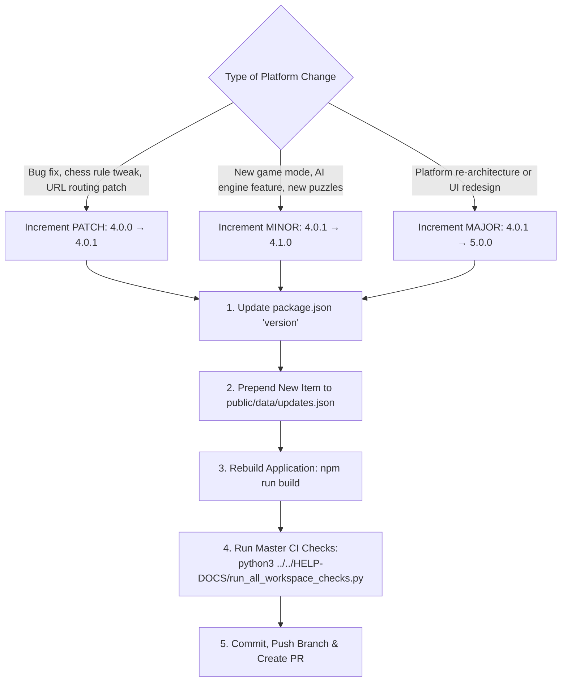

# Marwadi Chess Developer & Operations Manual (`mchess.eg1.in`)

This manual provides clear, comprehensive, step-by-step instructions to maintain, update, extend, and deploy the **`mchess.eg1.in`** platform without needing to inspect raw source code.

---

## 🏗️ 1. Architecture & Component Flow

`mchess.eg1.in` is an independent React 18 + TypeScript + Vite Single Page Application (SPA) powered by `chess.js` for rules validation and consuming `eg-web-core` as a modular dependency.

```mermaid
flowchart TD
    subgraph Browser["Client Browser & URL Engine"]
        URL["Clean URL: /playonline, /train, /dailypuzzles, /chessrules"]
        Router["App.tsx: Routing & Navigation"]
        URL --> Router
    end

    subgraph Pages["Chess Application Pages (src/pages/)"]
        PlayOnline["PlayOnlinePage.tsx (Multiplayer P2P/Rooms)"]
        PlayComp["PlayCompPage.tsx (Vs Computer AI)"]
        Train["TrainPage.tsx (Tactics Arena & Stockfish Analysis)"]
        DailyPuzzles["DailyPuzzlesPage.tsx (Daily Problem Spotlight)"]
        ChessRules["ChessRulesPage.tsx (Interactive Rules Guide)"]
        ChessTraps["ChessTrapsPage.tsx (Opening Traps Catalog)"]
        PgnGames["PgnGamesPage.tsx (Historical Master Games DB)"]
        MyGames["MyGamesPage.tsx (PGN Export & Local Match History)"]
        WatchLive["WatchLivePage.tsx (Top Lichess/Broadcast TV)"]
        Blog["BlogPage.tsx (Mate-in-N Puzzles & Quotes)"]
        Updates["UpdatesPage.tsx (Platform Changelog)"]
        About["AboutPage.tsx (Platform Story & FAQ)"]
        Admin["AdminPage.tsx (2FA Protected Admin Suite)"]
    end

    Router --> PlayOnline
    Router --> PlayComp
    Router --> Train
    Router --> DailyPuzzles
    Router --> ChessRules
    Router --> ChessTraps
    Router --> PgnGames
    Router --> MyGames
    Router --> WatchLive
    Router --> Blog
    Router --> Updates
    Router --> About
    Router --> Admin
```



---

## ♟️ 2. Procedure: Add, Edit, or Remove a Game Mode or Page

### How to Add a New Page:
1. **Create the Page Component** in `src/pages/MyNewModePage.tsx`:
   ```tsx
   import React from 'react';
   import { Container, PageHeader } from 'eg-web-core';

   export const MyNewModePage: React.FC = () => {
     return (
       <div className="new-mode-page">
         <Container>
           <PageHeader title="New Chess Variant" subtitle="Explore alternative rules." />
           <p>Game canvas and board controls...</p>
         </Container>
       </div>
     );
   };
   ```

2. **Register the Clean Route in `src/App.tsx`**:
   - In `renderCurrentPage()`:
     ```tsx
     case 'new-mode':
       return <MyNewModePage />;
     ```
   - In `MCHESS_NAV_LINKS`:
     ```tsx
     {
       label: 'NEW VARIANT',
       href: 'new-mode',
       icon: <Icon name="gamepad" size={14} />,
     }
     ```

---

## 🧩 3. Procedure: Adding Puzzles, Opening Traps & Quotes

Content is stored in `public/data/mchess-data.json` and `public/data/pgn/`:

### A. How to Add a Mate-in-N Tactical Puzzle:
Add to the `"articles"` array in `public/data/mchess-data.json`:
```json
{
  "id": 1222,
  "title": "Tactical Mate in 2: Queen Deflection",
  "category": "Mate in 2",
  "fen": "r1bqkb1r/pppp1ppp/2n5/4p3/2B1n3/5N2/PPPP1PPP/RNBQK2R w KQkq - 0 4",
  "solution": "1. Bxf7+ Kxf7 2. Nxe5#",
  "description": "White sacrifices the bishop on f7 to deliver a forced mate.",
  "difficulty": "Intermediate"
}
```

### B. How to Add a Grandmaster Chess Quote:
Add to `public/data/mchess-data.json` with category `"Chess Quotes"`:
```json
{
  "id": 1223,
  "title": "Garry Kasparov on Tactical Intuition",
  "category": "Chess Quotes",
  "author": "Garry Kasparov",
  "quote": "Tactics involve calculations that can be visually traced forward from the current position.",
  "source": "My Great Predecessors"
}
```

### C. How to Add an Opening Trap:
Append standard PGN notation into `public/data/pgn/opening_traps.pgn`:
```pgn
[Event "Stafford Gambit: Blackburne Trap"]
[Site "Marwadi Chess"]
[Date "2026.11.03"]
[Round "1"]
[White "Opponent"]
[Black "Hero"]
[Result "0-1"]

1. e4 e5 2. Nf3 Nc6 3. Bc4 Nd4 4. Nxe5 Qg5 5. Nxf7 Qxg2 6. Rf1 Qxe4+ 7. Be2 Nf3# 0-1
```

---

## 🔐 4. Procedure: Configure Admin Security

Administrative verification uses the same 2FA defense (Google OAuth + 16-Digit Salted PIN).
Create `.env` in `MCHESS-WEBSITE/mchess.eg1.in/`:
```ini
VITE_ADMIN_ALLOWED_EMAILS=admin@example.com
VITE_ADMIN_PIN_HASH=your_computed_sha256_hash_here
VITE_ADMIN_PIN_SALT=your_secret_salt_here
```

---

## 🚀 5. Development, Build & Deployment Commands

Run these commands from `MCHESS-WEBSITE/mchess.eg1.in/`:

```bash
# 1. Start local Vite development server (http://localhost:5173)
npm run dev

# 2. Type-check TypeScript code
npm run typecheck

# 3. Build optimized production bundle
npm run build

# 4. Preview the production build locally
npm run preview

# 5. Deploy to Firebase Hosting (Production)
firebase deploy --only hosting
```

---

## 🏷️ 6. How to Bump & Release a New Platform Version

`mchess.eg1.in` follows [Semantic Versioning (SemVer)](https://semver.org/): `MAJOR.MINOR.PATCH` (e.g. `4.0.0` → `4.0.1`).

> [!IMPORTANT]
> **Single Source of Truth (SSOT)**: Marwadi Chess dynamically reads the current platform version displayed in the logo badge, navigation bar, and homepage from the first item in [`public/data/updates.json`](../public/data/updates.json). Both `package.json` and `updates.json` must be updated together.



### Step-by-Step Procedure:

1. **Update `package.json`**:
   Open [`package.json`](../package.json) and bump the `"version"` field:
   ```json
   {
     "name": "mchess-eg1-in",
     "version": "4.0.1",
     ...
   }
   ```

2. **Add Changelog Entry to `public/data/updates.json`**:
   Open [`public/data/updates.json`](../public/data/updates.json) and prepend a new entry at the very top:
   ```json
   [
     {
       "id": "v4-0-1-clean-urls-routing-and-developer-documentation",
       "version": "4.0.1",
       "title": "Clean URL Routing Hardening & Hierarchical Developer Documentation Suite",
       "message": "Enforced clean extension-agnostic URL navigation across all platform routes and contact links. Published exhaustive modular developer documentation.",
       "icon": "fa-shield-halved",
       "badge": "Patch Release",
       "badgeColor": "#10b981",
       "link": "https://github.com/EG1DOTIN/mchess.eg1.in",
       "date": "Nov 03, 2026",
       "pinned": true
     },
     ...
   ]
   ```
   *Note: Set `"pinned": true` on the latest release to highlight it in the notifications tray.*

3. **Verify Build & Type Safety**:
   ```bash
   npm run build
   ```

4. **Run Master Workspace Verification**:
   ```bash
   python3 ../../HELP-DOCS/run_all_workspace_checks.py
   ```

5. **Commit & Deploy**:
   ```bash
   git add package.json public/data/updates.json
   git commit -m "chore(release): bump mchess.eg1.in to 4.0.1"
   # To deploy to production:
   firebase deploy --only hosting
   ```


