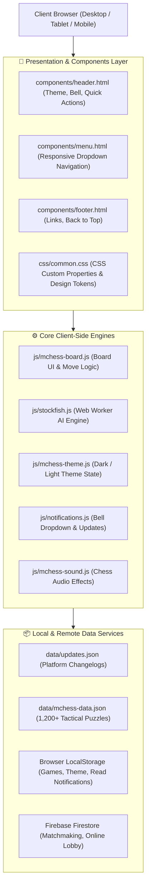

# 📚 Marwadi Chess — Technical & Page Documentation

Welcome to the comprehensive documentation directory for **Marwadi Chess** ([mchess.eg1.in](https://mchess.eg1.in)). This directory contains detailed architectural, interaction, and component documentation for every page and core engine in the platform.

---

## 🗂️ Documentation Directory (`docs/page-details/`)

| Page / Feature Module | Detail Document | Primary Role & Core Purpose | Source Code |
| :--- | :--- | :--- | :--- |
| **Home Portal Hub** | [details-index.md](page-details/details-index.md) | Central landing gateway with 12 interactive feature cards and quick-action navigation. | [`index.html`](../index.html) |
| **Play Online Arena** | [details-playonline.md](page-details/details-playonline.md) | Real-time matchmaking, 1-click room challenges, digital chess clocks, and pass & play. | [`playonline.html`](../playonline.html) |
| **Play vs Computer** | [details-playcomp.md](page-details/details-playcomp.md) | Browser chess vs Stockfish AI engine across 20 difficulty levels with smart hints. | [`playcomp.html`](../playcomp.html) |
| **Daily Chess Puzzles** | [details-dailypuzzles.md](page-details/details-dailypuzzles.md) | Daily tactical puzzles with dynamic hints, solution viewer, and streak tracker. | [`dailypuzzles.html`](../dailypuzzles.html) |
| **Train Yourself** | [details-train.md](page-details/details-train.md) | Checkmate training drills (Mate in 2 to 5), speed sprints, and zen practice. | [`train.html`](../train.html) |
| **Basic Chess Rules** | [details-chessrules.md](page-details/details-chessrules.md) | Interactive learning academy with playable piece movement explorer, special rules & quiz. | [`chessrules.html`](../chessrules.html) |
| **Learn Chess Traps** | [details-chesstraps.md](page-details/details-chesstraps.md) | Opening traps explorer with structured Bait, Blunder, and Refutation lesson cards. | [`chesstraps.html`](../chesstraps.html) |
| **PGN Games Database** | [details-pgngames.md](page-details/details-pgngames.md) | Grandmaster master games archive with move notation tree, autoplay, and board replay. | [`pgngames.html`](../pgngames.html) |
| **Watch Top Live Games** | [details-watchlive.md](page-details/details-watchlive.md) | 6-channel international tournament broadcast center with Theater and Grid modes. | [`watchlive.html`](../watchlive.html) |
| **Chess Blog & Quotes** | [details-blog.md](page-details/details-blog.md) | Categorized articles, tactical studies, embedded interactive puzzle boards, and Web Share API. | [`blog.html`](../blog.html) |
| **Website Updates Feed** | [details-updates.md](page-details/details-updates.md) | Chronological platform changelog, release notes, and engine improvements feed. | [`updates.html`](../updates.html) |
| **My Played Games Archive** | [details-mygames.md](page-details/details-mygames.md) | Match history tracker with win rate statistics, interactive replay board, and PGN export. | [`mygames.html`](../mygames.html) |
| **About Marwadi Chess** | [details-about.md](page-details/details-about.md) | Platform background, educational mission statement, learning philosophy, and roadmap. | [`about.html`](../about.html) |
| **Admin Panel** | [details-admin.md](page-details/details-admin.md) | Internal administrative dashboard for managing content, updates, and telemetry. | [`AdminPanel/`](../AdminPanel/) |
| **Interactive Board Engine** | [details-mchess-board.md](page-details/details-mchess-board.md) | Reusable `MChessEngineBoard` class powering responsive boards, sounds, and legal validation. | [`js/mchess-board.js`](../js/mchess-board.js) |
| **Notifications System** | [details-notifications.md](page-details/details-notifications.md) | Header notification bell dropdown showing latest 5 announcements with full history link. | [`js/notifications.js`](../js/notifications.js) |
| **Chess Puzzles Hub** | [details-chesspuzzles.md](page-details/details-chesspuzzles.md) | Curated tactical problem collections, mate datasets, and puzzle solving infrastructure. | [`data/`](../data/) |

---

## 🏛️ Platform Architecture Overview

---

## 🔍 Development Guidelines & Code Standards

- **Vanilla Web Stack**: Semantic HTML5, modern CSS with CSS Custom Properties, and ES6+ JavaScript.
- **Local Python Environment**: All local tooling and scripts must execute within the project-root virtual environment (`.venv/bin/python`).
- **Dependency Isolation**: Requirements are managed strictly through designated `requirements.txt` manifests without cross-contamination.
- **Accessibility & Responsiveness**: Mobile-first responsive breakpoints, minimum 44×44px touch targets, full keyboard navigability, and WCAG AA contrast compliance.
- **Zero Asset Regressions**: All pages share unified header, navigation, theme toggling, and 1-click refresh capabilities.
