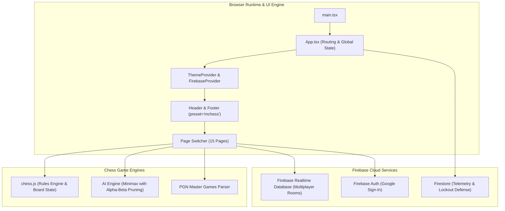
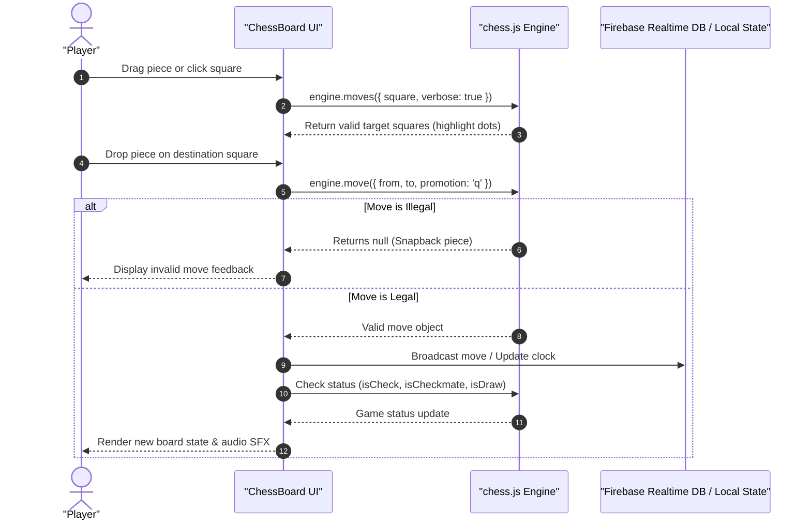

# Architecture & Chess Engine Integration — Marwadi Chess

This document outlines the architecture, chess engine integration, multiplayer synchronization, and administrative security powering [`mchess.eg1.in`](../).

---

## 🏗️ Architectural Topology

---

## 1. Move Evaluation Flow (`chess.js`)

All chess interactions are mediated through an instance of `Chess` from `chess.js`:

---

## 2. Real-Time Multiplayer Architecture (`PlayOnlinePage`)

Online games leverage Firebase Realtime Database with light-weight room management:
- **Room Lifecycle**: Hosts create a game room (`/rooms/{roomId}`) with clock settings (e.g., 3+2, 5+0, 10+0).
- **Matchmaking & Pairing**: Guests join using room codes or public lobby listings.
- **Move Synchronization**: Moves are dispatched as compact algebraic notation strings (e.g., `e2e4`, `g1f3`) with millisecond timestamps to synchronize chess clocks accurately across network latencies.
- **Disconnection Handling**: Presence monitoring handles automatic resignations on prolonged disconnections.

---

## 3. Computer AI Opponent (`PlayCompPage`)

The single-player engine provides multiple difficulty levels:
- **Level 1 (Beginner)**: Semi-random legal move selection with immediate capture prioritization.
- **Level 2 (Club Player)**: Material evaluation with 2-ply lookahead.
- **Level 3 (Master)**: Minimax search with alpha-beta pruning, positional piece-square tables, and center control heuristics.

---

## 4. Routing & Admin Mode Isolation

The router in [`App.tsx`](../src/App.tsx) detects administrative routes (`/admin`, `admin.html`, `/AdminPanel`) and isolates the workstation:
- Public navigation, sidebars, and footers are replaced by the full-screen [`AdminLayout`](https://github.com/EG1DOTIN/eg-web-core/blob/main/docs/admin-suite.md).
- One-click navigation back to the chess portal is provided via `headerActions={<ExitToMChessButton />}`.

---

## 5. Admin Security Model

- **Google OAuth Whitelist**: Restricted to `marwadichess@gmail.com`.
- **16-Digit Salted PIN**: Salted with `MCHESS_ADMIN_SECURE_SALT_2026` and hashed via standard browser Web Crypto API.
- **Brute-Force Lockout**: 3 failed attempts activate a 24-hour IP lockout recorded in `admin_lockout`.
- **Audit Logging**: Successful and failed authentications appended to `admin_login_log`.
