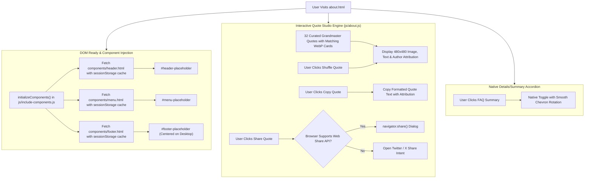

# Page Documentation: About Us (`about.html`)

> [!NOTE]
> The **About Us** page shares the mission, 4,500-year Indian chess heritage (*Chaturanga* & *Ashtapada*), open-source philosophy, interactive platform pillars, and contact information for the Marwadi Chess portal. It features a modern card-based ecosystem, an interactive Grandmaster quote studio with dynamic shuffle, clipboard copy, and Web Share API integrations.

---

## 1. Page Layout & ASCII Wireframe

```
+-----------------------------------------------------------------------------------+
|  TOP BAR / HEADER PLACEHOLDER (#header-placeholder)                               |
|  [Logo: Marwadi Chess]    [Daily Puzzle] [Play Online] [Theme Toggle 🌙/☀️]       |
+-----------------------------------------------------------------------------------+
|  NAVIGATION MENU PLACEHOLDER (#menu-placeholder)                                  |
|  [HOME]  [LEARN v]  [PUZZLES v]  [PLAY v]  [EXPLORE v]  [ABOUT (active)]          |
+-----------------------------------------------------------------------------------+
|  MAIN CONTENT CONTAINER (.box-100 .bg-E3 .main-master / .demo-about-container)    |
|                                                                                   |
|  +-----------------------------------------------------------------------------+  |
|  |  1. HERO BANNER (.demo-about-hero)                                          |  |
|  |  [✦ Open-Source Chess Platform]                                            |  |
|  |  [Title: Master the Art of Strategy with Marwadi Chess]                     |  |
|  |  [Subtitle: Community-driven chess learning, traps, drills, and philosophy] |  |
|  |  [⚔️ Play Online]    [🤖 Challenge Stockfish]    [🧭 Explore Features ↓]    |  |
|  +-----------------------------------------------------------------------------+  |
|                                                                                   |
|  +-----------------------------------------------------------------------------+  |
|  |  2. PLATFORM METRICS GRID (.demo-stats-grid)                                |  |
|  |  [ 500+ Tactics ] [ 20 Engine Levels ] [ 6 GM Channels ] [ 100% Free ]      |  |
|  +-----------------------------------------------------------------------------+  |
|                                                                                   |
|  +-----------------------------------------------------------------------------+  |
|  |  3. CHESS QUOTE STUDIO (.demo-quote-studio)                                 |  |
|  |  +---------------------------+  +----------------------------------------+  |  |
|  |  | [Enlarged 480x480 Quote   |  | [Tag: Daily Strategic Mindset]         |  |  |
|  |  |  Card Image: id5.webp]   |  | [“Chess is the struggle against error”]|  |  |
|  |  |                           |  | [Author: Johannes Zukertort]           |  |  |
|  |  +---------------------------+  | [🎲 Shuffle] [📋 Copy] [📤 Share]     |  |  |
|  |                                 +----------------------------------------+  |  |
|  +-----------------------------------------------------------------------------+  |
|                                                                                   |
|  +-----------------------------------------------------------------------------+  |
|  |  4. 4,500-YEAR HERITAGE & CULTURE SECTION (.demo-heritage-card)             |  |
|  |  [Ancient Indian origins: Chaturanga & Ashtapada in the Indus Valley era]   |  |
|  |  [Evolution Timeline: 2500 BCE -> 6th Century -> 7th-15th -> Today]        |  |
|  +-----------------------------------------------------------------------------+  |
|                                                                                   |
|  +-----------------------------------------------------------------------------+  |
|  |  5. EXPLORE THE ECOSYSTEM (3-Column Feature Grid)                           |  |
|  |  [Live Play Online]   [Play vs Stockfish]   [Daily Chess Tactics]           |  |
|  |  [Tactics Trainer]    [Opening Traps]       [Watch Top Live Games]          |  |
|  |  [PGN Game Archives]  [Rules & Studies]                                     |  |
|  +-----------------------------------------------------------------------------+  |
|                                                                                   |
|  +-----------------------------------------------------------------------------+  |
|  |  6. TECHNOLOGY BEHIND THE BOARD (.demo-tech-section)                        |  |
|  |  [Stockfish 16 Engine] [Lichess API] [WebRTC PeerJS] [Vector Staunton Board] |  |
|  |  [Vanilla ES6+ Engine] [CSS Custom Tokens]                                 |  |
|  +-----------------------------------------------------------------------------+  |
|                                                                                   |
|  +-----------------------------------------------------------------------------+  |
|  |  7. FREQUENTLY ASKED QUESTIONS (.demo-faq-section)                           |  |
|  |  [v Is Marwadi Chess free to use? -> 100% Free Open-Source]                 |  |
|  |  [> Do I need to register? -> Currently not required]                       |  |
|  |  [> Can I play on mobile or tablet? -> Full mobile-first touch support]     |  |
|  |  [> How is player privacy protected? -> Strict privacy, no trackers]       |  |
|  |  [> Can I contribute? -> Open-source contributions on GitHub]              |  |
|  +-----------------------------------------------------------------------------+  |
|                                                                                   |
|  +-----------------------------------------------------------------------------+  |
|  |  8. GUIDING PRINCIPLES & CONTRIBUTION CTA                                   |  |
|  |  [Open Source Spirit] [Privacy-First] [Universal Access] [Community Driven]  |  |
|  |  [GitHub Repository Link]    [Contact Us Link]    [Privacy Policy Link]     |  |
|  +-----------------------------------------------------------------------------+  |
+-----------------------------------------------------------------------------------+
|  FOOTER PLACEHOLDER (#footer-placeholder) (Desktop Centered)                      |
|  [Brand Bio]    [Chess Puzzles]    [Explore & Community]    [Social Links]        |
|  Copyright (C) 2026 Marwadi Chess  |  Privacy Policy        [^ Back to Top]       |
+-----------------------------------------------------------------------------------+
```

---

## 2. Interaction & Architecture Flow



---

## 3. Component Architecture & Section Breakdown

1. **Hero Section (`.demo-about-hero`)**:
   - Features a clean badge (`Open-Source Chess Platform`) with queen icon.
   - Primary `h1` heading with gold gradient accent styling.
   - Direct CTA links navigating to [Play Online](../../playonline.html), [Play vs Stockfish](../../playcomp.html), and Feature Exploration.

2. **Platform Metrics Grid (`.demo-stats-grid`)**:
   - 5 responsive metric counters showcasing platform capabilities:
     - `500+` Curated Tactics & Checkmate Puzzles
     - `20` Stockfish Engine Difficulty Levels
     - `6` Live GM Broadcast Channels
     - `100%` Free & Open-Source Features
     - `0` Intrusive Ads or Tracking Profiles

3. **Interactive Chess Quote Studio (`.demo-quote-studio`)**:
   - **Enlarged Visual Display**: Displays an enlarged **480x480px** high-resolution graphic card (`+78%` visual area over legacy layout).
   - **Accessibility**: Combines the graphic card with native HTML blockquote text and author attribution for screen readers.
   - **Interactive Actions**:
     - `Shuffle Quote`: Cycles dynamically through curated Grandmaster quote cards without page reloads.
     - `Copy Quote`: Copies clean quote text and attribution to clipboard with animated visual feedback (`Copied!`).
     - `Share Quote`: Triggers Web Share API Level 2 with image file attachment (`files: [imageFile]`) directly sharing the quote card image. When shared via URL, links to the dedicated static landing page (`https://mchess.eg1.in/blog/CQ%20-%20X.htm`) where social crawlers (WhatsApp, Facebook, Discord, Twitter/X) render the exact quote card thumbnail via `<meta property="og:image">`.
     - `All Quotes →`: Direct link to quote category in blog.

4. **Heritage & Culture Showcase (`.demo-heritage-card`)**:
   - Chronicles the 4,500-year history of chess from ancient Indian *Chaturanga* and *Ashtapada* (Indus Valley era, 2500 BCE) to international chess and modern open-source web platforms.

5. **Feature Exploration Grid (`.demo-features-grid`)**:
   - 8 responsive cards with category tags, descriptions, and action buttons linking to all core tools:
     - Live Play Online, Play vs. Stockfish, Daily Chess Tactics, Tactics Trainer, Opening Traps, Watch Top Live Games, PGN Game Archives, Rules & Studies.

6. **Tech Stack & Architecture Grid (`.demo-tech-grid`)**:
   - Details the open-source engineering behind Marwadi Chess: Stockfish 16 WASM, Lichess Open API, WebRTC PeerJS, Vector Staunton SVG Board, Vanilla ES6+ Engine, and CSS Custom Tokens.

7. **Semantic FAQ Accordion (`.demo-faq-list`)**:
   - Implemented using native HTML5 `<details>` and `<summary>` elements for zero-dependency keyboard accessibility.
   - Clarifies that all currently implemented features are 100% free to use and account registration is not required.

8. **Guiding Principles & Community CTA (`.demo-principles-grid` & `.demo-cta-card`)**:
   - Highlights Open Source Spirit, Privacy-First, Universal Access, and Community Driven core values.
   - Provides direct links to the official [GitHub Repository](https://github.com/EG1DOTIN/mchess.eg1.in), [Contact Page](https://eg1.in/contact.html), and [Privacy Policy](../../privacypolicy.html).

---

## 4. Key Feature Modules & Source Files

- **Live HTML Page**: [`about.html`](../../about.html)
- **Master Stylesheet**: [`css/about.css`](../../css/about.css)
- **Interactive Script**: [`js/about.js`](../../js/about.js)
- **Header Component**: [`components/header.html`](../../components/header.html)
- **Navigation Menu**: [`components/menu.html`](../../components/menu.html)
- **Footer Component**: [`components/footer.html`](../../components/footer.html)
- **Core Design Tokens**: [`css/common.css`](../../css/common.css) & [`css/responsive.css`](../../css/responsive.css)

---

## 5. Styling & Theme Tokens

The About page uses CSS custom properties defined in [`css/about.css`](../../css/about.css) with seamless Light and Dark theme support:

| Token / Variable | Light Mode Value | Dark Mode Value (`[data-theme="dark"]`) | Description |
| :--- | :--- | :--- | :--- |
| `--about-gold-main` | `#d4af37` | `#d4af37` | Primary royal gold accent |
| `--about-gold-light` | `#fbbf24` | `#fbbf24` | Highlight gold hover |
| `--about-bg-surface` | `#ffffff` | `#1e293b` | Card surface background |
| `--about-bg-subtle` | `#f8fafc` | `#0f172a` | Container subtle background |
| `--about-border` | `#e2e8f0` | `#334155` | Card boundary border |
| `--about-text-heading`| `#0f172a` | `#f8fafc` | High-contrast title typography |
| `--about-text-body` | `#334155` | `#cbd5e1` | Primary paragraph text |
| `--about-text-muted` | `#64748b` | `#94a3b8` | Supporting metadata & labels |

---

## 6. Desktop Centering & Mobile Responsiveness

> [!TIP]
> - **Desktop Footer Centering**: Wrapped inside `<center><div>...<div id="footer-placeholder"></div></div></center>` to guarantee `.box-90` in the footer aligns identically with the rest of the website on wide monitors.
> - **Quote Studio Breakpoints**:
>   - Desktop (`> 1100px`): `480px 1fr` grid with `36px` gap.
>   - Laptop (`881px - 1100px`): `420px 1fr` grid with `28px` gap.
>   - Tablet & Mobile (`<= 880px`): Single-column stacked layout with `max-width: 480px; margin: 0 auto;`.
> - **Zero Cumulative Layout Shift (CLS)**: Asynchronous component caching via `sessionStorage` ensures header, menu, and footer mount instantly on repeat visits.

---

*Document prepared for Marwadi Chess repository architecture. All rights reserved.*
