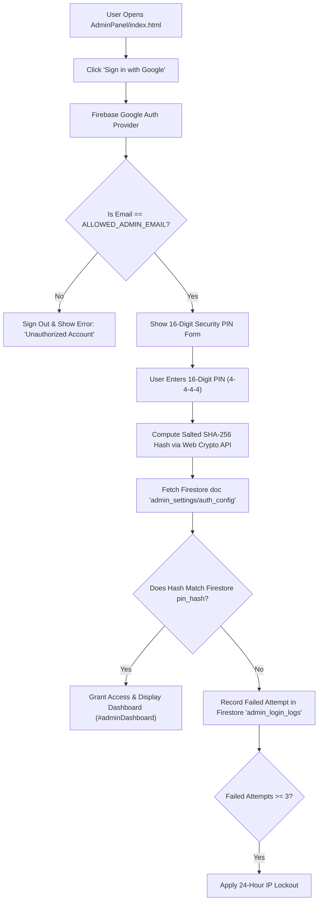

# Page Documentation: Admin Panel (`AdminPanel/index.html`)

> [!NOTE]
> The Admin Panel (`AdminPanel/index.html`) is a secure, standalone management portal for article publishing, category configuration, analytics monitoring, and visitor tracking.

---

## 1. Page Layout & ASCII Wireframe

```
+-----------------------------------------------------------------------------------+
|  STEP 1: GOOGLE SIGN-IN CONTAINER (#loginContainer)                                |
|  +-----------------------------------------------------------------------------+  |
|  |  MCHESS Admin Panel Login                                                   |  |
|  |  [ Button: Sign in with Google (Authorized Admin Email Only) ]              |  |
|  +-----------------------------------------------------------------------------+  |
+-----------------------------------------------------------------------------------+
|  STEP 2: 16-DIGIT SECURITY PIN UNLOCK FORM (#firestorePinForm)                    |
|  +-----------------------------------------------------------------------------+  |
|  |  Enter 16-Digit Admin Security PIN                                          |  |
|  |  [ [••••] — [••••] — [••••] — [••••] ]                                       |  |
|  |  [ Button: Unlock Panel ]   [ Button: Cancel & Logout ]                     |  |
|  +-----------------------------------------------------------------------------+  |
+-----------------------------------------------------------------------------------+
|  STEP 3: MAIN ADMIN DASHBOARD (#adminDashboard)                                   |
|  +-----------------------+-----------------------------------------------------+  |
|  | SIDEBAR NAVIGATION    | DASHBOARD CONTENT VIEW                              |  |
|  | - Dashboard           | +--------------------+  +-------------------------+ |  |
|  | - Analytics           | | Total Visitors     |  | Active Blog Posts       | |  |
|  | - Blogs (CRUD)        | +--------------------+  +-------------------------+ |  |
|  | - Blog Categories     |                                                     |  |
|  | - Messages            | ARTICLE MANAGER TABLE (#blogsTableBody)             |  |
|  | - Logout              | [ Title | Category | Release Date | Actions ]       |  |
|  +-----------------------+-----------------------------------------------------+  |
+-----------------------------------------------------------------------------------+
```

---

## 2. Three-Layer Security & Authentication Flow



---

## 3. Key Modules & Source References

- **HTML View**: [`AdminPanel/index.html`](../../AdminPanel/index.html)
- **Authentication & Security Engine**: [`AdminPanel/js/auth.js`](../../AdminPanel/js/auth.js)
- **Dashboard & CRUD Logic**: [`AdminPanel/js/app.js`](../../AdminPanel/js/app.js)
- **Analytics Visualization**: [`AdminPanel/js/analytics.js`](../../AdminPanel/js/analytics.js)
- **Stylesheets**: [`AdminPanel/css/admin-style.css`](../../AdminPanel/css/admin-style.css)

---

## 4. Open Source Security & Hardening Checklist

> [!IMPORTANT]
> The Admin Panel is safe to publish in an open-source repository because:
> 1. **No Plaintext Passwords in Source**: The PIN is never hardcoded. Only its salted SHA-256 hash is verified against Cloud Firestore at runtime.
> 2. **Cloud Firestore Rules Protection**: `admin_settings` and `visitor_analytics` collections are protected by Firestore security rules requiring authenticated admin credentials.
> 3. **Automatic Cache Invalidation**: Saving or deleting blogs automatically clears `localStorage` client caches (`mchess_blogs_cache`, `mchess_categories_cache`).
