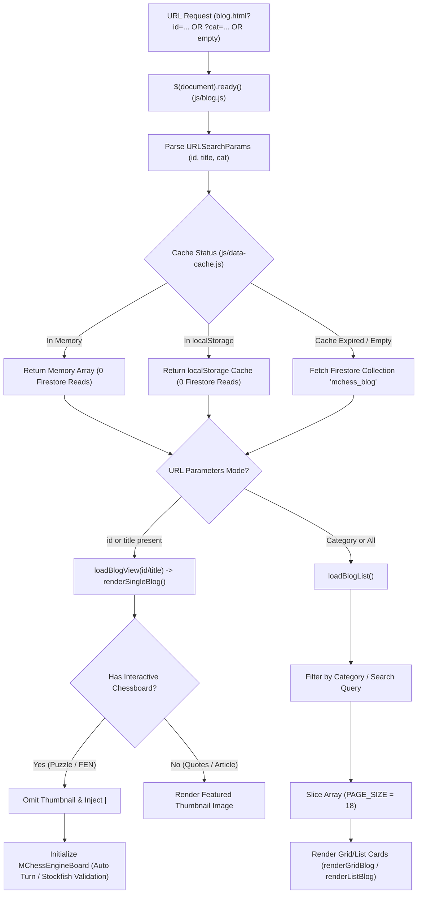

# Page Documentation: Blog Engine & Articles (`blog.html`)

> [!NOTE]
> The Blog Engine (`blog.html` & `js/blog.js`) renders chess articles, puzzle writeups, chess quotes, history, and tactics categories dynamically from Cloud Firestore with local 1-hour `localStorage` caching.
> When viewing interactive puzzle blogs, it embeds the live `MChessEngineBoard` with dynamic Stockfish move validation, auto-perspective detection, and seamless in-place transitions without scrolling or page reload.

---

## 1. Page Layout & ASCII Wireframe

```
+-----------------------------------------------------------------------------------+
|  HEADER & NAVIGATION COMPONENTS (Dynamic AJAX Injection)                           |
+-----------------------------------------------------------------------------------+
|  BLOG PAGE HEADER (#blog-page-heading)                                            |
|  [ Heading: "Latest Blogs" / Category Name / Post Title ]                         |
+---------------------------------------------------+-------------------------------+
|  MAIN ARTICLES CONTAINER (#blogs-container)       | SIDEBAR (#category-sidebar)   |
|                                                   |                               |
|  [ Search Input: #txtSearch ]  [ Button: Search ] | [ Categories List ]           |
|                                                   |  - Learn Chess                |
|  +---------------------------------------------+  |  - Chess Quotes               |
|  | Single Blog View:                           |  |  - Chess Puzzles              |
|  | Header: <category> | <title>                |  |  - Chess History              |
|  | (Thumbnails omitted for live puzzle boards) |  |  - Mate in 2 / 3 / 4 / 5      |
|  |                                             |  |                               |
|  | Interactive Engine Board (Auto-Perspective) |  | [ Related Topics ]            |
|  | [ Status Banner: Turn / Solved / Defense ]  |  |  - Article Link 1             |
|  | [ In-Category Detail Pagination & Share ]   |  |  - Article Link 2             |
|  | [ << Prev ] [ 1 ] [ 2 ] [ Next >> ]  [ 📤 Share ] |  - Article Link 3             |
|  +---------------------------------------------+  |                               |
+---------------------------------------------------+-------------------------------+
|  FOOTER COMPONENT (Dynamic AJAX Injection)                                        |
+-----------------------------------------------------------------------------------+
```

---

## 2. Dynamic Blog State Machine & Data Flow



---

## 3. Key Functions & Code Reference Map

| Function | File Location | Responsibility |
| :--- | :--- | :--- |
| `DataCache.getBlogs()` | [`js/data-cache.js`](../../js/data-cache.js#L53) | Fetches and caches blog objects with 1-hour TTL |
| `loadBlogList()` | [`js/blog.js`](../../js/blog.js#L229) | Handles paginated grid/list rendering for articles |
| `loadBlogView()` | [`js/blog.js`](../../js/blog.js#L299) | Initiates single blog loading by `id` or `title` query |
| `renderSingleBlog()` | [`js/blog.js`](../../js/blog.js#L330) | Unified single blog renderer updating titles, meta, DOM, and engine board in place |
| `renderBlogView()` | [`js/blog.js`](../../js/blog.js#L606) | Constructs blog markup, formats `<category> \| <title>` header, and omits static thumbnails for live boards |
| `handleBlogPuzzleSolved()` | [`js/blog.js`](../../js/blog.js#L377) | Solved notification and auto-timer triggering in-place next puzzle transition |
| `transitionToBlogPuzzle()` | [`js/blog.js`](../../js/blog.js#L407) | In-place puzzle transition with zero DOM tear-down and zero mobile scroll twitching |
| `renderDetailPagination()` | [`js/blog.js`](../../js/blog.js#L710) | Generates in-category navigation controls (`« Previous`, numbers, `Next »`) with right-aligned Share button |
| `#btnShareBlogItem` click | [`js/blog.js`](../../js/blog.js#L137) | Shares public static `blog/<title>.htm` landing page URL with turn and mate text via Web Share API or clipboard copy |
| `getBlogTurnAndMate()` | [`js/blog.js`](../../js/blog.js#L119) | Calculates 'White/Black to move and Mate in N' from puzzle FEN or description |
| `getBlogImageUrl()` | [`js/blog.js`](../../js/blog.js#L540) | Resolves Firestore relative image paths (`img/mi2/`, `img/mi3/`, `img/mi4/`, `img/cpcq/`) to `.webp` with fallback |
| `escapeHtml()` | [`js/blog.js`](../../js/blog.js#L860) | Sanitizes text content against XSS before injection |

---

## 4. Move Validation, In-Place Transitions & Social Sharing Specification

### 4.1 Move Validation in Puzzle Blogs (`MChessEngineBoard`)
1. **Pre-Move Bestmove Verification**: Captures `prevFen` (position before the player's move) and queries Stockfish for the top calculated `bestmove`. If the played move matches `bestmove` (e.g. `1... Qb5!`), it is accepted as the true best move.
2. **Strict Mate-in-N Move Budgeting**:
   - On the final allowed move ($k = N$), the move must be an immediate checkmate (`chess.in_checkmate()`). Suboptimal moves (e.g. `4. Bxh6` taking 5 moves) are rejected with `"Incorrect move! Does not force Mate in N."`.
   - On intermediate turns ($k < N$), alternate moves must strictly guarantee mate within $|mateVal| \le (N - k)$ moves without extra ply padding.
3. **Scaled Calculation Times**:
   - **Mate in 2**: `2000ms` (`depth 14`, `movetime 1800ms`)
   - **Mate in 3**: `4000ms` (`depth 16`, `movetime 3800ms`)
   - **Mate in 4**: `6000ms` (`depth 18`, `movetime 5800ms`)
   - Early-resolves as soon as Stockfish outputs `bestmove` for fast response.
4. **Permanent Grandmaster Level 20**: Defaulted `skillLevel: 20` for all puzzle blogs, ensuring optimal engine calculations and defenses.
5. **Context-Aware Solved Notifications**: Checks `chess.in_checkmate()` to show `"🎉 Checkmate! Puzzle Solved!"` for true checkmate and `"🎉 Puzzle Solved!"` for material tactical puzzles.

### 4.2 Auto-Perspective & Clean Heading Architecture
- **Dynamic Content Updates**: When auto-advancing or clicking in-category pagination buttons (`« Prev`, `1`, `2`, `Next »`), `renderSingleBlog()` updates the full description text, author info, category metadata, and active pagination state in place without full page reloads.
- **Auto Turn & Flip**: When a puzzle has Black to move (`turn === 'b'`), the board automatically flips to Black, selects `"Play as Black ♚"` in `#userSideSelect`, and configures Black pieces for drag and click-to-move.
- **Dynamic Turn & Mate Heading**: Formats the header directly above the board as `<h2 class="puzzle-blog-heading">{title}: {turnAndMate}</h2>`, providing clear context on move turn and mate depth.

### 4.3 Static SEO URL Sharing & 1200x630 Social Cards Architecture
When users click `#btnShareBlogItem`, the app shares the static wrapper URL (`https://mchess.eg1.in/blog/<title>.htm`):
- **Web Crawlers**: Social scrapers (Facebook, X.com, WhatsApp, Telegram) crawl the pre-rendered static wrapper and discover the uncropped $1200 \times 630$ px Open Graph card (`img/og/<title>.webp`), complete with official branding, centered White/Black to move badges, and green CTA button.
- **In-App Players**: Humans who click the link land directly in the interactive SPA (`blog.html?title=<title>`) with zero-reload next-puzzle transitions.

```javascript
// In-App Share Button: Shares static SEO URL with turn & mate text
$(document).on('click', '#btnShareBlogItem', async function(e) {
    e.preventDefault();
    var $btn = $(this);
    var title = $btn.attr('data-title') || (currentLoadedBlog && currentLoadedBlog.title) || 'Marwadi Chess';
    var turnAndMate = getBlogTurnAndMate(currentLoadedBlog);
    var shareUrl = 'https://mchess.eg1.in/blog/' + encodeURIComponent(title) + '.htm';
    var shareTitle = turnAndMate ? (title + ': ' + turnAndMate + ' | Marwadi Chess') : (title + ' | Marwadi Chess');
    var shareMessage = turnAndMate 
        ? 'Can you solve ' + title + ' (' + turnAndMate + ')? Solve it interactively:' 
        : 'Check out ' + title + ' on Marwadi Chess:';

    if (navigator.share) {
        try {
            await navigator.share({ title: shareTitle, text: shareMessage, url: shareUrl });
            showShareCopied($btn, 'Shared!');
            return;
        } catch (err) {
            if (err.name === 'AbortError') return;
        }
    }
    fallbackCopyShareLink($btn, shareMessage + ' ' + shareUrl);
});
```

---

## 5. Security & Performance Notes

> [!TIP]
> - All HTML output is sanitized via `escapeHtml()` and `escapeAttr()` to prevent script injection.
> - Images are loaded with native `loading="lazy"` to minimize network payload on page load.
> - Firestore document reads are reduced by 95%+ via 1-hour persistent client-side caching.
> - Blog card elements dynamically adapt to global CSS custom properties (`--bg-primary`, `--text-primary`, `--card-bg`) across Dark and Light modes.
