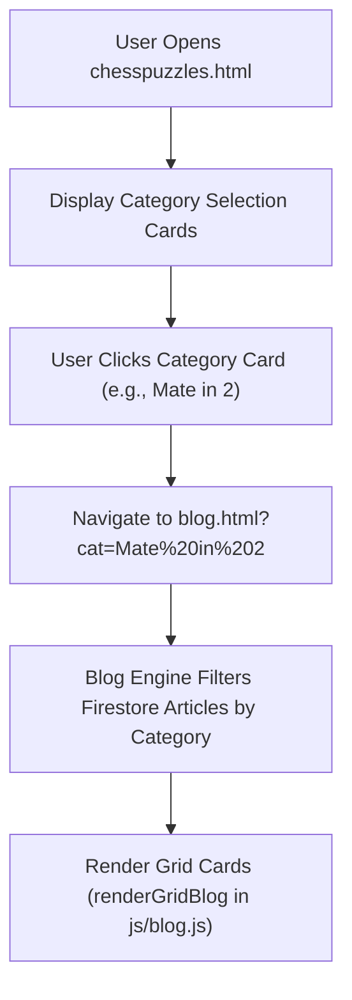

# Page Documentation: Chess Puzzles Directory (`chesspuzzles.html`)

> [!NOTE]
> The Chess Puzzles page provides a curated directory of chess puzzles categorized by tactical theme and difficulty (Mate in 2, Mate in 3, Mate in 4, Tactical Blunders).

---

## 1. Page Layout & ASCII Wireframe

```
+-----------------------------------------------------------------------------------+
|  HEADER & NAVIGATION COMPONENTS (Dynamic AJAX Injection)                           |
+-----------------------------------------------------------------------------------+
|  PAGE TITLE: "Chess Puzzles Collection"                                           |
+-----------------------------------------------------------------------------------+
|  PUZZLE CATEGORY CARDS GRID                                                       |
|                                                                                   |
|  +------------------------+  +------------------------+  +---------------------+  |
|  |  Mate in 2 Puzzles     |  |  Mate in 3 Puzzles     |  |  Mate in 4 Puzzles  |  |
|  |  (blog.html?cat=Mate2) |  |  (blog.html?cat=Mate3) |  | (blog.html?cat=Mate4|  |
|  +------------------------+  +------------------------+  +---------------------+  |
|                                                                                   |
|  +------------------------+  +------------------------+  +---------------------+  |
|  |  Tactical Blunders     |  |  Endgame Puzzles       |  |  Master Combinations|  |
|  |  (blog.html?cat=Tactics)  |  (blog.html?cat=Endgame)  | (blog.html?cat=Combos)|  |
|  +------------------------+  +------------------------+  +---------------------+  |
+-----------------------------------------------------------------------------------+
|  FOOTER COMPONENT (Dynamic AJAX Injection)                                        |
+-----------------------------------------------------------------------------------+
```

---

## 2. Dynamic Navigation Flow



---

## 3. Key Assets & Source References

- **Interactive Puzzle Solver**: [`dailypuzzles.html`](../../dailypuzzles.html)
- **Puzzle Archive & Blog Hub**: [`blog.html?cat=Chess%20Puzzles`](../../blog.html) & [`js/blog.js`](../../js/blog.js)
- **Data Persistence**: [`js/data-cache.js`](../../js/data-cache.js)

---

## 4. Performance & Security Notes

> [!TIP]
> - Category links pass URL-encoded parameters (`encodeURIComponent`) preventing broken query syntax.
> - Images feature `loading="lazy"` to prevent high initial HTTP request overhead.
