# Page Documentation: Basic Chess Rules Academy (`chessrules.html`)

> [!NOTE]
> The Basic Chess Rules Academy (`chessrules.html`, `css/chessrules.css`, & `js/chessrules.js`) provides an interactive, beginner-to-intermediate learning platform. It features a playable **Piece Movement Explorer**, step-by-step **Special Moves Demonstrators** (Castling & En Passant), an **Interactive Rules Quiz**, a sticky **Table of Contents** with scroll-spy navigation, and an illustrated chess rules encyclopedia.

---

## 1. Page Layout & ASCII Wireframe

```
+-----------------------------------------------------------------------------------+
|  HEADER & NAVIGATION COMPONENTS (Dynamic AJAX Injection)                           |
+-----------------------------------------------------------------------------------+
|  HERO BANNER: "Learn Chess Rules - Complete Beginner to Master Guide"              |
|  [ Badge: 6 Piece Types ] [ Badge: Special Rules ] [ Badge: Interactive Quiz ]    |
+---------------------------------------------------+-------------------------------+
|  STICKY TABLE OF CONTENTS (.rules-toc-nav)        | MAIN RULES CONTENT            |
|                                                   |                               |
|  1. The Chessboard & Setup                        | 1. THE CHESSBOARD & SETUP     |
|  2. How Every Piece Moves (Explorer)              | - Board geometry (8x8, 64 sq) |
|  3. Special Moves (Castling, En Passant)          | - Initial piece placement     |
|  4. Check, Checkmate & Stalemate                  | - #initialSetupBoard (start)  |
|  5. Draw Rules & Regulations                      |                               |
|  6. Interactive Rules Quiz                        | 2. PIECE MOVEMENT EXPLORER    |
|                                                   | [ Pawn | Knight | Bishop ... ]|
|                                                   | +-------------+ +-----------+ |
|                                                   | | #explorer-  | | Piece     | |
|                                                   | |   Board     | | Details,  | |
|                                                   | | (Legal dots | | Points,   | |
|                                                   | |  & Captures)| | Tips list | |
|                                                   | +-------------+ +-----------+ |
|                                                   |                               |
|                                                   | 3. SPECIAL CHESS MOVES        |
|                                                   | A. Castling Demonstrator      |
|                                                   |    [ Kingside 0-0 ] [ 0-0-0 ] |
|                                                   |    #castleDemoBoard           |
|                                                   | B. En Passant Demonstrator    |
|                                                   |    [ Step 1 ] [ Step 2 ]      |
|                                                   |    #enPassantDemoBoard        |
|                                                   | C. Pawn Promotion Breakdown   |
|                                                   |                               |
|                                                   | 4. CHECK & CHECKMATE          |
|                                                   | 5. DRAW CONDITIONS            |
|                                                   |                               |
|                                                   | 6. INTERACTIVE RULES QUIZ     |
|                                                   | [ Q1: Castling rights? ]      |
|                                                   |   ( ) Opt A   (•) Opt B       |
|                                                   |   [ Feedback Banner: Success ]|
|                                                   | [ Q2: En Passant timing? ]    |
|                                                   | [ Q3: Stalemate outcome? ]    |
+---------------------------------------------------+-------------------------------+
|  FOOTER COMPONENT (Dynamic AJAX Injection)                                        |
+-----------------------------------------------------------------------------------+
```

---

## 2. Interactive Academy Architecture & Data Flow

```mermaid
flowchart TD
    User["User Visits chessrules.html"] --> Init["$(document).ready() (js/chessrules.js)"]
    
    Init --> PieceMod["PieceExplorer Controller"]
    Init --> SpecMod["SpecialMovesDemo Controller"]
    Init --> QuizMod["RulesQuiz Controller"]
    Init --> TocMod["initScrollSpy() Controller"]
    
    subgraph PieceExplorerFlow["Piece Movement Explorer"]
        TabClick["User Clicks Piece Tab (.rules-piece-tab)"]
        LoadFEN["board.position(PIECES_DATA[piece].fen)"]
        DrawMarkers["renderHighlights(): Append .rules-legal-dot & .rules-capture-ring"]
        DropValidation["handlePieceDrop(): Validate against PIECES_DATA.targets"]
        
        TabClick --> LoadFEN --> DrawMarkers --> DropValidation
    end
    
    subgraph SpecialMovesFlow["Special Moves Demonstrators"]
        CastleClick["User Clicks [Kingside 0-0] or [Queenside 0-0-0]"]
        CastleAnim["castleBoard.position(fen, true) with Safe Rook Jump"]
        
        EpClick["User Clicks [Step 1] -> [Step 2]"]
        EpAnim1["Step 1: Black d7-d5 adjacent pawn advance"]
        EpAnim2["Step 2: White exd6 En Passant capture"]
        
        CastleClick --> CastleAnim
        EpClick --> EpAnim1 --> EpAnim2
    end
    
    subgraph QuizFlow["Interactive Rules Quiz"]
        QuizClick["User Selects Option (.rules-quiz-opt)"]
        CheckCorrect{"data-correct === true?"}
        ShowSuccess["Add .correct & Show .rules-quiz-feedback.success"]
        ShowError["Add .incorrect & Show .rules-quiz-feedback.error"]
        
        QuizClick --> CheckCorrect
        CheckCorrect -->|"Yes"| ShowSuccess
        CheckCorrect -->|"No"| ShowError
    end
    
    subgraph ScrollSpyFlow["Scroll-Spy & Smooth Navigation"]
        Scroll["User Scrolls Window"] --> DetectAnchor["Match offset().top with .rules-section-anchor"]
        DetectAnchor --> UpdateActive["Set .active on matching .rules-toc-link"]
    end
    
    PieceMod --> PieceExplorerFlow
    SpecMod --> SpecialMovesFlow
    QuizMod --> QuizFlow
    TocMod --> ScrollSpyFlow
```



---

## 3. Key Data Structures & Code Snippets

### 3.1 Piece Definition Dataset (`PIECES_DATA`)

Each chess piece is configured with its isolated board FEN, central coordinate, valid target squares, point valuation, and movement summary:

```javascript
const PIECES_DATA = {
    pawn: {
        name: 'The Pawn',
        points: '1 Point',
        symbol: '♟',
        fen: '8/8/8/8/8/2p1p3/3P4/8 w - - 0 1',
        pieceSquare: 'd2',
        targets: ['d3', 'd4', 'c3', 'e3'],
        summary: 'Pawns move 1 square straight forward. On their very first move, they have the option to advance 2 squares. Unlike other pieces, pawns capture 1 square diagonally ahead.',
        tips: [
            'Advances straight, captures diagonally.',
            'Can move 2 squares forward only from its starting rank.',
            'Transforms into a Queen, Rook, Bishop, or Knight upon reaching the 8th rank (Promotion).',
            'Can execute the special diagonal "En Passant" capture against adjacent pawns.'
        ]
    },
    knight: {
        name: 'The Knight',
        points: '3 Points',
        symbol: '♞',
        fen: '8/8/8/3N4/8/8/8/8 w - - 0 1',
        pieceSquare: 'd5',
        targets: ['c7', 'e7', 'f6', 'f4', 'e3', 'c3', 'b4', 'b6'],
        summary: 'The Knight moves in a distinct "L-shape": two squares in one direction, then one square perpendicular. It is the ONLY piece on the chessboard that can jump over other pieces!',
        tips: [
            'Always lands on a square of the opposite color from where it started.',
            'Cannot be blocked by intervening friendly or enemy pieces.',
            'Controls up to 8 squares from the center of the board.'
        ]
    },
    queen: {
        name: 'The Queen',
        points: '9 Points',
        symbol: '♛',
        fen: '8/8/8/3Q4/8/8/8/8 w - - 0 1',
        pieceSquare: 'd5',
        targets: [
            'd8', 'd7', 'd6', 'd4', 'd3', 'd2', 'd1',
            'a5', 'b5', 'c5', 'e5', 'f5', 'g5', 'h5',
            'c6', 'b7', 'a8', 'e6', 'f7', 'g8',
            'c4', 'b3', 'a2', 'e4', 'f3', 'g2', 'h1'
        ],
        summary: 'The Queen is the most powerful piece in chess. She combines the movement powers of the Rook and Bishop, moving in any straight line (horizontal, vertical, diagonal) any distance.',
        tips: [
            'Controls up to 27 squares simultaneously from the center.',
            'Worth 9 points — protect her from early traps and attacks.',
            'Almost always the piece chosen during pawn promotion.'
        ]
    }
};
```

### 3.2 Piece Explorer Highlight Injection (`renderHighlights`)

Target squares are dynamically highlighted using CSS overlays inserted directly into the Chessboard.js square DOM elements:

```javascript
renderHighlights(pieceKey) {
    // Clear existing highlight markers
    this.$container.find('.rules-legal-dot, .rules-capture-ring').remove();

    const data = PIECES_DATA[pieceKey];
    if (!data || !data.targets) return;

    data.targets.forEach(sq => {
        const $sq = this.$container.find(`.square-${sq}`);
        if ($sq.length) {
            // If target square has an enemy piece, render capture ring, otherwise green dot
            if ($sq.find('img').length > 0) {
                $sq.append('<div class="rules-capture-ring"></div>');
            } else {
                $sq.append('<div class="rules-legal-dot"></div>');
            }
        }
    });
}
```

### 3.3 Special Moves Step-by-Step Controller (`SpecialMovesDemo`)

Interactive boards allow users to execute Castling and En Passant in real time:

```javascript
// Kingside Castling: King moves e1 -> g1, Rook jumps h1 -> f1
$('#btnCastleKingside').on('click', () => {
    this.castleBoard.position('r3k2r/8/8/8/8/8/8/R4RK1 b kq - 1 1', true);
    $('#castleStatusText').html('<i class="fas fa-shield-alt" style="color:#22c55e;"></i> <strong>Kingside Castling (0-0)</strong> executed! King is tucked safely on g1.');
});

// En Passant Step 1 & 2 Execution
$('#btnEpStep1').on('click', () => {
    this.enPassantBoard.position('8/8/8/3pP3/8/8/8/8 w - d6 0 2', true);
    $('#epStatusText').html('<i class="fas fa-arrow-down" style="color:#38bdf8;"></i> <strong>Step 1:</strong> Black moves d7 to d5, landing directly adjacent to White\'s e5 pawn.');
    $('#btnEpStep2').prop('disabled', false).css('opacity', 1);
});

$('#btnEpStep2').on('click', () => {
    this.enPassantBoard.position('8/8/3P4/8/8/8/8/8 b - - 0 2', true);
    $('#epStatusText').html('<i class="fas fa-bolt" style="color:#f59e0b;"></i> <strong>Step 2 (En Passant):</strong> White captures diagonally to d6! Black\'s d5 pawn is eliminated.');
});
```

### 3.4 Interactive Rules Quiz Validation

Questions check answers stored in data attributes (`data-correct="true"`), rendering explanatory feedback instantly:

```javascript
$('.rules-quiz-opt').on('click', function () {
    const $opt = $(this);
    const $box = $opt.closest('.rules-quiz-box');
    const isCorrect = $opt.data('correct') === true;
    const feedbackText = $opt.data('feedback') || '';

    $box.find('.rules-quiz-opt').removeClass('correct incorrect');
    if (isCorrect) {
        $opt.addClass('correct');
        $box.find('.rules-quiz-feedback')
            .removeClass('error')
            .addClass('show success')
            .html(`<i class="fas fa-check-circle"></i> <strong>Correct!</strong> ${feedbackText}`);
    } else {
        $opt.addClass('incorrect');
        $box.find('.rules-quiz-feedback')
            .removeClass('success')
            .addClass('show error')
            .html(`<i class="fas fa-times-circle"></i> <strong>Incorrect.</strong> ${feedbackText}`);
    }
});
```

---

## 4. Key Assets & Source References

- **Source HTML**: [chessrules.html](../../chessrules.html)
- **Stylesheet**: [css/chessrules.css](../../css/chessrules.css)
- **Interactive Script**: [js/chessrules.js](../../js/chessrules.js)
- **Board Library**: [chessboard.js](https://cdnjs.cloudflare.com/ajax/libs/chessboard-js/1.0.0/chessboard-1.0.0.min.js)

---

## 5. Security, Accessibility & Performance Notes

> [!TIP]
> - **Zero-Server Calculation**: All piece positions, legal move highlights, castling steps, and quiz validations execute entirely client-side with zero network latency.
> - **WCAG Compliance**: High-contrast colors for quiz feedback (`#22c55e` green for success, `#ef4444` red for error) and minimum 44px touch targets on piece selection tabs.
> - **Smooth Responsive Resizing & Centering**: All interactive boards (`#explorerBoard`, `#castleDemoBoard`, `#enPassantDemoBoard`, `#initialSetupBoard`) are sized to 270px on mobile (240px on small screens $\le 380\text{px}$) and centered horizontally via `margin: 0 auto;`.
> - **Mobile Gesture Touch-Action Safety**: Piece-drag selectors in [common.css](../../css/common.css) and [mchess-board.css](../../css/mchess-board.css) are strictly scoped to avoid intercepting touch events on `.rules-piece-card` elements, with an explicit `touch-action: pan-y !important;` rule ensuring smooth vertical scrolling on touch devices.
> - **Top-of-Page Initial View**: Excluded [chessrules.html](../../chessrules.html) from automated board centering scripts so mobile users immediately view the header and Table of Contents without layout shifts.
