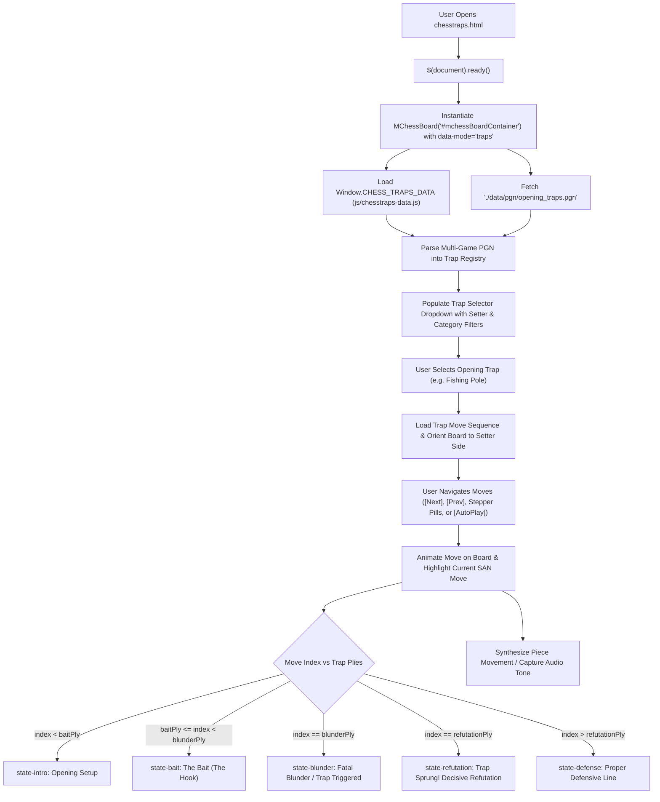

# Page Documentation: Learn Chess Traps (`chesstraps.html`)

> [!NOTE]
> The Learn Chess Traps page (`chesstraps.html`, `js/chesstraps-data.js`, & `js/mchess-board.js`) provides an interactive PGN-driven viewer and structured academy teaching players famous opening traps (Fishing Pole, Lasker Trap, Budapest Gambit, Monticelli, Scholar's Mate, Fried Liver, Legal's Trap, Noah's Ark, etc.) with step-by-step move synchronization, blunder/refutation highlighting, and dynamic lesson cards.

---

## 1. Page Layout & ASCII Wireframe

```
+-----------------------------------------------------------------------------------+
|  HEADER & NAVIGATION COMPONENTS (Dynamic AJAX Injection)                           |
+-----------------------------------------------------------------------------------+
|  PAGE TITLE: "Chess Opening Traps & Tricks"                                       |
+-----------------------------------------------------------------------------------+
|  MCHESS TRAPS CONTAINER (#mchessBoardContainer [data-pgn="..." data-mode="traps"])|
|                                                                                   |
|  +-- [ Trap Header & Metadata ] -----------------------------------------------+  |
|  |  Active Trap: "Fishing Pole Trap (Ruy Lopez: Berlin Defense)"               |  |
|  |  ECO: C65 | Category: 1.e4 Opening | Setter: ⚫ Played by Black              |  |
|  +-----------------------------------------------------------------------------+  |
|                                                                                   |
|     a   b   c   d   e   f   g   h           +-----------------------------------+ |
|   +---+---+---+---+---+---+---+---+         | TRAP SELECTOR & FILTER TABS       | |
| 8 | r |   | b | q | k | b | n | r | 8       | [ All ] [ White ] [ Black ] [ e4 ]| |
|   +---+---+---+---+---+---+---+---+         | [ Dropdown: Select Opening Trap ] | |
| 7 | p | p | p | p |   | p | p | p | 7       | - Fishing Pole Trap               | |
|   +---+---+---+---+---+---+---+---+         | - Lasker Trap                     | |
| 6 |   |   | n |   |   |   |   |   | 6       | - Budapest Trap                   | |
|   +---+---+---+---+---+---+---+---+         | - Monticelli Trap                 | |
| 5 |   |   |   |   | p |   |   |   | 5       +-----------------------------------+ |
|   +---+---+---+---+---+---+---+---+         | DYNAMIC LESSON CARD               | |
| 4 |   |   | B |   | P |   |   |   | 4       | [#trapDynamicCard: state-bait]    | |
|   +---+---+---+---+---+---+---+---+         | [Tag: The Bait (The Hook)]        | |
| 3 |   |   |   |   |   | N |   |   | 3       | "Black plays 4...Ng4 and 5...h5,  | |
|   +---+---+---+---+---+---+---+---+         | dangling the knight as bait..."   | |
| 2 | P | P | P | P |   | P | P | P | 2       +-----------------------------------+ |
|   +---+---+---+---+---+---+---+---+         | MOVE STEPPER PILLS                | |
| 1 | R | N | B | Q | K |   |   | R | 1       | [Intro] [Bait] [Blunder] [Refute] | |
|   +---+---+---+---+---+---+---+---+         +-----------------------------------+ |
|     a   b   c   d   e   f   g   h           | MOVE NOTATION HISTORY             | |
|                                             | 1. e4 e5   2. Nf3 Nc6             | |
|  CONTROLS TOOLBAR                           | 3. Bb5 Nf6 4. O-O Ng4             | |
|  - [|< First] [< Prev] [Next >] [>|]        | 5. h3 h5   6. hxg4?? [Blunder!]   | |
|  - [ ▶ Auto Play / ⏸ Pause ]               | 6... hxg4! [Refutation!]          | |
|  - [ 🔄 Flip Board ] [ 🎨 Theme ] [ 🔊 Sound ]                                    | |
+-----------------------------------------------------------------------------------+
|  FOOTER COMPONENT (Dynamic AJAX Injection)                                        |
+-----------------------------------------------------------------------------------+
```

---

## 2. Interaction & PGN Traversal Diagram



---

## 3. Educational Data Structures & Code Examples

### 3.1 Trap Lesson Schema (`CHESS_TRAPS_DATA`)

Stored in [`js/chesstraps-data.js`](../../js/chesstraps-data.js), each trap object contains exact ply milestones and instructive commentary:

```javascript
const CHESS_TRAPS_DATA = [
    {
        name: "Fishing Pole Trap",
        eco: "C65",
        opening: "Ruy Lopez: Berlin Defense, Fishing Pole Variation",
        setter: "black",
        category: "e4",
        baitPly: 7,       // 4...Ng4
        blunderPly: 10,   // 6. hxg4??
        refutationPly: 11,// 6...hxg4
        bait: "Black plays 4...Ng4 and 5...h5, boldly dangling the knight as 'bait' on g4.",
        blunder: "6. hxg4?? White gets greedy and captures the knight, opening the h-file for Black's rook.",
        refutation: "7...Qh4! brings Black's queen into the open h-file, forcing unstoppable checkmate (8.f3 g3 9.Bxc6 Qh1#).",
        defense: "6. d3 or 6. Re1 safely develops pieces and keeps the kingside completely secure.",
        tags: ["Ruy Lopez", "h-file Attack", "Checkmate"]
    },
    {
        name: "Lasker Trap",
        eco: "D08",
        opening: "Queen's Gambit Declined: Albin Countergambit",
        setter: "black",
        category: "d4",
        baitPly: 5,       // 3...d4
        blunderPly: 6,    // 4. e3?
        refutationPly: 7, // 4...Bb4+
        bait: "Black plays 2...e5 and 3...d4, establishing an advanced pawn wedge deep in White's territory.",
        blunder: "4. e3? Bb4+ 5. Bd2 dxe3! 6. Bxb4? exf2+ 7. Ke2 walks into a famous underpromotion trap.",
        refutation: "7...fxg1=N+! Underpromoting to a knight with check wins White's queen (if 8.Rxg1 Bg4+ skewers Ke2 to Qd1).",
        defense: "4. Nf3 Nc6 5. a3 or 5. g3 consolidates White's extra pawn with a solid advantage.",
        tags: ["Albin Countergambit", "Underpromotion", "Queen Skewer"]
    }
];
```

### 3.2 Dynamic Lesson Card Synchronization (`updateTrapCard`)

Implemented in [`js/mchess-board.js`](../../js/mchess-board.js), this method updates the card visual state, tag, move index, and stepper pills on every move:

```javascript
updateTrapCard(moveIndex) {
    if (!this.isTrapMode || !this.currentTrap) return;

    const trap = this.currentTrap;
    const $card = this.$container.find(`#trapDynamicCard_${this.uid}`);
    const $tag = this.$container.find(`#dynamicCardTag_${this.uid}`);
    const $ply = this.$container.find(`#dynamicCardPly_${this.uid}`);
    const $desc = this.$container.find(`#dynamicCardDesc_${this.uid}`);
    const $stepper = this.$container.find(`#trapStepper_${this.uid}`);

    $stepper.find('.trap-step-pill').removeClass('active');
    $card.removeClass('state-intro state-bait state-blunder state-refutation state-defense');

    const baitPly = typeof trap.baitPly === 'number' ? trap.baitPly : (trap.blunderPly > 0 ? trap.blunderPly - 1 : 0);
    const blunderPly = typeof trap.blunderPly === 'number' ? trap.blunderPly : 0;
    const refutationPly = typeof trap.refutationPly === 'number' ? trap.refutationPly : blunderPly + 1;

    if (moveIndex < baitPly) {
        $stepper.find('#pillIntro_' + this.uid).addClass('active');
        $card.addClass('state-intro');
        $tag.html('<i class="fas fa-flag-checkered"></i> Opening Setup');
        $desc.html(`<strong>${trap.name}</strong> in the <em>${trap.opening}</em>. Follow the moves or jump directly to the bait!`);
    } else if (moveIndex >= baitPly && moveIndex < blunderPly) {
        $stepper.find('#pillBait_' + this.uid).addClass('active');
        $card.addClass('state-bait');
        $tag.html('<i class="fas fa-fish"></i> The Bait (The Hook)');
        $desc.html(trap.bait);
    } else if (moveIndex === blunderPly) {
        $stepper.find('#pillBlunder_' + this.uid).addClass('active');
        $card.addClass('state-blunder');
        $tag.html('<i class="fas fa-exclamation-triangle"></i> Fatal Blunder');
        $desc.html(trap.blunder);
    } else if (moveIndex === refutationPly) {
        $stepper.find('#pillRefutation_' + this.uid).addClass('active');
        $card.addClass('state-refutation');
        $tag.html('<i class="fas fa-bolt"></i> Decisive Refutation');
        $desc.html(trap.refutation);
    } else {
        $stepper.find('#pillDefense_' + this.uid).addClass('active');
        $card.addClass('state-defense');
        $tag.html('<i class="fas fa-shield-alt"></i> Proper Defense');
        $desc.html(trap.defense);
    }
}
```

### 3.3 Move List Tactical Highlighting

In `renderMoveList()`, moves matching `blunderPly` and `refutationPly` are tagged with distinct classes:

```javascript
if (self.isTrapMode && self.currentTrap && typeof self.currentTrap.blunderPly === 'number') {
    if (moveNumber === self.currentTrap.blunderPly) {
        moveDiv.classList.add('trap-blunder-move');
        moveDiv.title = 'Fatal Blunder / Trap Triggered!';
    } else if (moveNumber === self.currentTrap.blunderPly + 1) {
        moveDiv.classList.add('trap-refutation-move');
        moveDiv.title = 'Trap Sprung! Decisive Refutation';
    }
}
```

---

## 4. Key Assets & Source References

- **Source File**: [`chesstraps.html`](../../chesstraps.html)
- **Board Controller**: [`js/mchess-board.js`](../../js/mchess-board.js)
- **Traps Educational Dataset**: [`js/chesstraps-data.js`](../../js/chesstraps-data.js)
- **Opening Traps PGN Database**: [`data/pgn/opening_traps.pgn`](../../data/pgn/opening_traps.pgn)
- **Board Styles**: [`css/mchess-board.css`](../../css/mchess-board.css)
- **Rules & Board Libraries**: `chess.js` (v0.10.3) & `chessboard.js` (v1.0.0)

---

## 5. Best Practices & Performance Notes

> [!TIP]
> - **Client-Side PGN Parsing**: All opening trap variations are parsed in the client browser, supporting instantaneous switching between traps without additional server requests.
> - **Board Orientation**: Users can click **Flip Board** to view traps from either White or Black's perspective to master both attacking moves and defensive responses. When a trap is selected, the board automatically defaults orientation to the trap setter's perspective (`black` or `white`).
> - **Interactive Stepper Navigation**: Players can jump directly to key milestones (Intro, Bait, Blunder, Refutation, Defense) using the `#trapStepper_` pills without stepping through every move manually.
