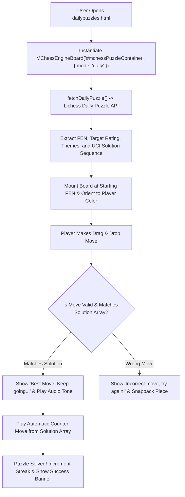

# Page Documentation: Daily Chess Puzzles (`dailypuzzles.html`)

> [!NOTE]
> Daily Chess Puzzles (`dailypuzzles.html` & `js/mchess-engine-board.js`) provides an interactive tactical trainer that dynamically fetches daily Grandmaster tactics (via Lichess Daily Puzzle API with fallback puzzle sets), evaluates moves in real-time, provides AI hints via Stockfish, and tracks player solving streaks.

---

## 1. Page Layout & ASCII Wireframe

```
+-----------------------------------------------------------------------------------+
|  HEADER & NAVIGATION COMPONENTS (Dynamic AJAX Injection)                           |
+-----------------------------------------------------------------------------------+
|  PAGE TITLE: "Daily Interactive Chess Puzzles & Tactics"                          |
+---------------------------------------------------+-------------------------------+
|  MAIN PUZZLE ENGINE CONTAINER (col-md-9)           | COMMUNITY EMBEDS (col-md-3)   |
|  (#mchessPuzzleContainer [data-mode="daily"])     |                               |
|                                                   | [ 👥 Facebook Group Card ]    |
|  +-- [ Mode Banner: Daily Puzzle - Rating: 1850 ] -+ |  - Direct Member Join Link    |
|  |  Status: "Your Turn (Black to Move)"            |                               |
|  |  [ Button: Solution ]  [ Button: Next Puzzle ]  | [ 📘 Facebook Page Embed ]    |
|  +-------------------------------------------------+                               |
|                                                   | [ 📷 Instagram Embed ]        |
|     a   b   c   d   e   f   g   h                 |                               |
|   +---+---+---+---+---+---+---+---+               | [ 🐦 Twitter/X Follow Button ]|
| 8 | r |   | b | q | k |   |   | r | 8             +-------------------------------+
|   +---+---+---+---+---+---+---+---+                                               |
| 7 | p | p | p |   |   | p | p | p | 7                                             |
|   +---+---+---+---+---+---+---+---+                                               |
| 6 |   |   | n |   |   |   |   |   | 6                                             |
|   +---+---+---+---+---+---+---+---+                                               |
| 5 |   |   |   | p |   |   |   |   | 5                                             |
|   +---+---+---+---+---+---+---+---+                                               |
| 4 |   |   | B | P |   |   |   |   | 4                                             |
|   +---+---+---+---+---+---+---+---+                                               |
| 3 |   |   | N |   |   |   |   |   | 3                                             |
|   +---+---+---+---+---+---+---+---+                                               |
| 2 | P | P | P |   | P | P | P | P | 2                                             |
|   +---+---+---+---+---+---+---+---+                                               |
| 1 | R |   | B | Q | K |   | N | R | 1                                             |
|   +---+---+---+---+---+---+---+---+                                               |
|     a   b   c   d   e   f   g   h                                                 |
|                                                                                   |
|  [ Controls: First | Prev | Next | Last | 💡 Hint | 🔄 Reset | 🔊 Sound ]         |
+-----------------------------------------------------------------------------------+
|  FOOTER COMPONENT (Dynamic AJAX Injection)                                        |
+-----------------------------------------------------------------------------------+
```

---

## 2. Puzzle Solver Workflow



---

## 3. Key Assets & References

- **Source HTML**: [`dailypuzzles.html`](../../dailypuzzles.html)
- **Board Controller**: [`js/mchess-engine-board.js`](../../js/mchess-engine-board.js)
- **FEN Parser Utility**: [`js/mchess-fen-parser.js`](../../js/mchess-fen-parser.js)
- **Board Styles**: [`css/mchess-board.css`](../../css/mchess-board.css)
- **Rules & Board Libraries**: `chess.js` (v0.10.3) & `chessboard.js` (v1.0.0)

---

## 4. Best Practices & Performance Notes

> [!TIP]
> - **Permanent Grandmaster Level 20**: The Stockfish engine automatically defaults to Level 20 (Grandmaster) for accurate daily tactical evaluations.
> - **Pre-Move Bestmove Verification**: Verifies alternative moves against Stockfish's top calculated `bestmove` directly from the position before the move (`prevFen`), preventing suboptimal checks from bypassing puzzle requirements.
> - **Context-Aware Solved Banners**: Checks `chess.in_checkmate()` on completion: shows `🎉 Checkmate! Puzzle Solved!` for mate puzzles and `🎉 Puzzle Solved!` for winning material advantage.
> - **API Fallback Grace**: If network connectivity prevents fetching the live daily puzzle API, the controller seamlessly falls back to pre-bundled offline tactical puzzle positions.
> - **Interactive Hints**: Clicking the **Hint** button communicates with Stockfish to calculate the best legal piece to move without spoiling the full variation.
> - **Tone Feedback**: Success and failure states are reinforced with dynamic audio feedback via Web Audio API.

