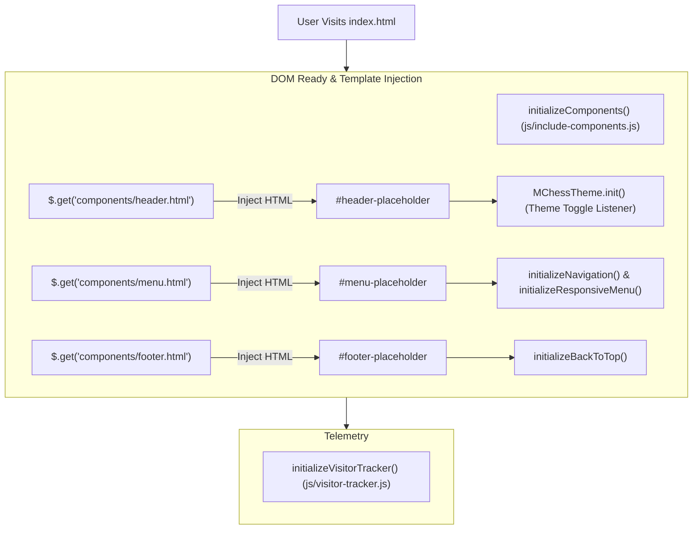

# Page Documentation: Home Page (`index.html`)

> [!NOTE]
> The Home Page serves as the primary landing page and navigational hub for the Marwadi Chess portal, introducing users to feature categories, quick-action cards, live play links, theme toggle, and latest articles.

---

## 1. Page Layout & ASCII Wireframe

```
+-----------------------------------------------------------------------------------+
|  TOP BAR / HEADER PLACEHOLDER (#header-placeholder)                               |
|  [Logo: Marwadi] [Notifications 🔔] [Play Online] [Theme 🌙] [Refresh 🔄]          |
+-----------------------------------------------------------------------------------+
|  NAVIGATION MENU PLACEHOLDER (#menu-placeholder)                                  |
|  [HOME]  [LEARN v]  [PUZZLES v]  [PLAY v]  [EXPLORE v]  [ABOUT]                   |
+-----------------------------------------------------------------------------------+
|  FEATURE CARDS GRID (.mainContentHeader / #welcome)                               |
|                                                                                   |
|  [ROW 1: PLAY & TACTICS]                                                          |
|  +------------------+  +------------------+  +------------------+  +--------------+
|  |  Play Online     |  |  Play vs         |  |  Daily Chess     |  | Train        |
|  |  Timed Arena     |  |  Stockfish       |  |  Tactics Trainer |  | Yourself     |
|  |  (playonline)    |  |  (playcomp)      |  |  (dailypuzzles)  |  | (train)      |
|  +------------------+  +------------------+  +------------------+  +--------------+
|                                                                                   |
|  [ROW 2: LEARN & MASTER]                                                          |
|  +------------------+  +------------------+  +------------------+  +--------------+
|  |  Basic Chess     |  |  Learn Chess     |  |  PGN Games       |  | Watch Top    |
|  |  Rules           |  |  Traps           |  |  Database        |  | Live Games   |
|  |  (chessrules)    |  |  (chesstraps)    |  |  (pgngames)      |  | (watchlive)  |
|  +------------------+  +------------------+  +------------------+  +--------------+
|                                                                                   |
|  [ROW 3: COMMUNITY & PLATFORM]                                                    |
|  +------------------+  +------------------+  +------------------+  +--------------+
|  |  Chess Blog      |  |  Chess Quotes    |  |  Website         |  | About        |
|  |  Directory       |  |  Category        |  |  Updates Feed    |  | Marwadi Chess|
|  |  (blog.html)     |  |  (blog.html?cat) |  |  (updates.html)  |  | (about.html) |
|  +------------------+  +------------------+  +------------------+  +--------------+
+-----------------------------------------------------------------------------------+
|  FOOTER PLACEHOLDER (#footer-placeholder)                                         |
|  [Brand Bio]    [Chess Puzzles]    [Explore & Community]    [Social Links]        |
|  Copyright (C) 2026 Marwadi Chess  |  Privacy Policy        [^ Back to Top]       |
+-----------------------------------------------------------------------------------+
```

---

## 2. Interaction & Component Flow



---

## 3. Key Feature Modules & Source Files

- **Source HTML**: [`index.html`](../../index.html)
- **Header Component**: [`components/header.html`](../../components/header.html)
- **Navigation Menu Component**: [`components/menu.html`](../../components/menu.html)
- **Footer Component**: [`components/footer.html`](../../components/footer.html)
- **Theme Controller**: [`js/mchess-theme.js`](../../js/mchess-theme.js)
- **Component Loader Script**: [`js/include-components.js`](../../js/include-components.js)
- **Page Initialization Script**: [`js/index.js`](../../js/index.js)
- **Global Stylesheets**: [`css/common.css`](../../css/common.css), [`css/main.css`](../../css/main.css), [`css/menuCss.css`](../../css/menuCss.css)

---

## 4. Open Source & Security Checklist

> [!TIP]
> - **1-Click App Refresh & Cache Purge (`#appRefreshBtn`)**: Allows users and developers to purge stale browser asset caches (`caches.delete()`) and force a cache-bypassing reload in 1 click. Features smart mid-game detection with safety warnings so active matches and saved games are never lost.
> - **Standardized 4-Line Feature Cards**: All 12 feature cards utilize CSS line-clamping (`-webkit-line-clamp: 4`) with balanced copy (~118–128 characters) so every description completes within 4 lines ending in a visible full stop (`.`) on all viewport sizes.
> - **All links on the homepage** point to relative internal pages or secure `https://` external URLs.
> - **Theme preference** (`dark` or `light`) is saved in `localStorage` and applied instantly on DOM load to prevent layout flicker.
> - **Web Site Schema JSON-LD** structured data is included in `<head>` for search engine indexing.

