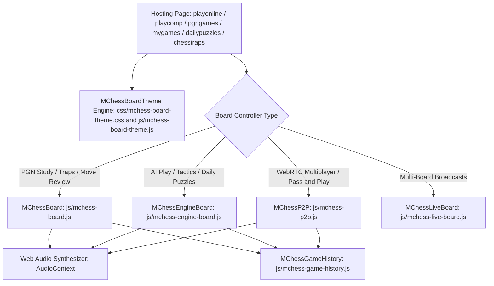
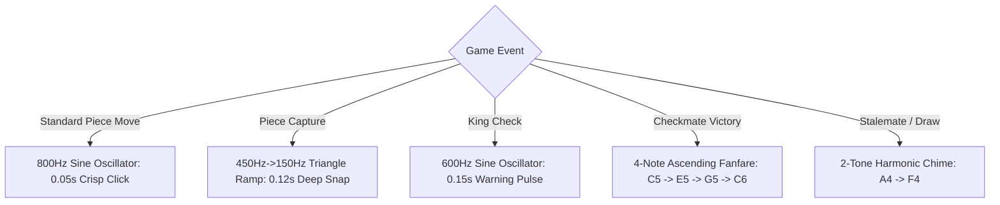

# Centralized Component Documentation: MCHESS Interactive Board & Theme Engine

> [!NOTE]
> This document details the unified 2D chessboard architecture, responsive board presentation, multi-theme customization system, zero-asset Web Audio engine, and controller modules across the Marwadi Chess web platform.

---

## 1. Architectural Overview

The MCHESS board ecosystem is a modular, high-performance, client-side chess interface designed for rapid analysis, engine play, live multiplayer, puzzle solving, and grandmaster game study. It seamlessly integrates [Chessboard.js](https://chessboardjs.com/) for 2D board rendering, [chess.js](https://github.com/jhlywa/chess.js) for move generation and validation, and custom MCHESS engines for theme customization, audio synthesis, and PGN serialization.



---

## 2. Board Layout & Visual Wireframe

```
+-----------------------------------------------------------------------------------+
|  PGN VIEWER / ENGINE / MATCH ARENA CONTAINER (.pgn-viewer-container)              |
+-----------------------------------------------------------------------------------+
|  HEADER BAR: Title, Tech Pill, Status Banner / Live Turn Notification             |
+-----------------------------------------------------------------------------------+
|  +---------------------------------------------+-------------------------------+  |
|  |  BOARD COLUMN (.board-column)               |  INFO COLUMN (.info-column)   |  |
|  |  +---------------------------------------+  |  +-------------------------+  |  |
|  |  | BOARD WRAPPER (.board-wrapper)        |  |  | PLAYERS & METADATA CARD |  |  |
|  |  |                                       |  |  | White Player vs Black   |  |  |
|  |  |       8x8 INTERACTIVE CHESSBOARD      |  |  | Result Badge: [ 1-0 ]   |  |  |
|  |  |       (#board_xxxx / #mchessP2pBoard) |  |  | Date | Site | ECO Tag   |  |  |
|  |  |                                       |  |  +-------------------------+  |  |
|  |  |  [a-h] File & [1-8] Rank Coordinates  |  |  | MODE BANNER / TRAP CARD |  |  |
|  |  +---------------------------------------+  |  | Watching Main Line      |  |  |
|  |                                             |  +-------------------------+  |  |
|  |  CONTROLS TOOLBAR (.controls-bar)           |  | SAN MOVES NOTATION LIST |  |  |
|  |  [ |< First ] [ < Prev ] [ > Next ] [ >| ]  |  | 1. e4      e5           |  |  |
|  |  [ Flip Board ] [ Theme (Palette) ]         |  | 2. Nf3     Nc6          |  |  |
|  |  [ Speed / Side / Engine Level Selectors ]  |  | 3. Bb5     a6           |  |  |
|  |                                             |  +-------------------------+  |  |
|  |  KEYBOARD HINTS & VARIATION NOTICE          |  | TRIAL VARIATION BOX     |  |  |
|  |  "Drag pieces anytime to analyze trial moves"|  | (Active during trial)  |  |  |
|  +---------------------------------------------+-------------------------------+  |
+-----------------------------------------------------------------------------------+
```

---

## 3. Centralized Multi-Theme Customizer

The board appearance is governed by [mchess-board-theme.css](../../css/mchess-board-theme.css) and [mchess-board-theme.js](../../js/mchess-board-theme.js). The chosen theme is stored in `localStorage` under the key `mchess_board_theme` and applied to `document.documentElement` via the `data-board-theme` attribute to guarantee instant, zero-flicker rendering.

### 3.1 Available Themes Specification

| Theme ID | Theme Name | Light Square | Dark Square | Light Text | Dark Text | Border / Accents |
| :--- | :--- | :--- | :--- | :--- | :--- | :--- |
| `mchess-slate` | **Classic Slate (Default)** | `#e6e6e6` | `#616261` | `#1e293b` | `#f8fafc` | `#475569` / Golden Accent |
| `lichess-wood` | **Lichess Wood** | `#f0d9b5` | `#b58863` | `#4a2e18` | `#fff3e6` | `#8b5a2b` / Wood Timber |
| `chessbase-blue` | **ChessBase Blue** | `#dee3e6` | `#4e7c99` | `#0f2738` | `#f0f9ff` | `#33536b` / Pro Blue |
| `tournament-green` | **Emerald Green** | `#eeeed2` | `#769656` | `#263816` | `#f7fee7` | `#4a6333` / Tournament Buff |
| `midnight-dark` | **Midnight Sapphire** | `#cbd5e1` | `#1e3a8a` | `#091e42` | `#eff6ff` | `#0f172a` / Deep Sapphire |

### 3.2 CSS Custom Properties Architecture

```css
/* Custom Square Tokens */
.white-1e1d7, [class*="white-"] {
    background-color: var(--mchess-sq-light, #e6e6e6) !important;
    color: var(--mchess-sq-light-text, #1e293b) !important;
    transition: background-color 0.25s ease, color 0.25s ease;
}

.black-3c85d, [class*="black-"] {
    background-color: var(--mchess-sq-dark, #616261) !important;
    color: var(--mchess-sq-dark-text, #f8fafc) !important;
    transition: background-color 0.25s ease, color 0.25s ease;
}

.board-wrapper {
    border-color: var(--mchess-board-border, #475569) !important;
    transition: border-color 0.25s ease;
}
```

### 3.3 Theme Picker Modal

- **Interactive Swatches**: Every theme card displays a realistic mini 4-square chessboard preview.
- **Universal Event Delegation**: Clicking any `.btn-board-theme` element across any page opens the picker modal.
- **Keyboard & Touch Accessible**: Supports `Enter`/`Space` activation, `Esc` dismissal, and touch targets exceeding 44×44px.

---

## 4. Zero-Asset Web Audio Synthesizer Engine

All chess sound effects are generated synthetically in real-time using the native HTML5 `AudioContext` API, requiring **zero external audio file downloads**.



---

## 5. Core Board Controllers

### 5.1 `MChessBoard` ([`js/mchess-board.js`](../../js/mchess-board.js))
- **Purpose**: Power interactive PGN databases ([pgngames.html](../../pgngames.html), [chesstraps.html](../../chesstraps.html)) and move-by-move match reviews ([mygames.html](../../mygames.html)).
- **Trial Variation Engine**: Allows players to drag pieces at any move number to branch into custom analysis lines, displaying a dedicated variation box with an instant "Back to Game" reset button.
- **Autoplay & Navigation**: Step backward/forward, jump to start/end, flip board, and adjustable autoplay timer (0.5s, 1s, 2s).
- **Traps Mode Engine (`data-mode="traps"`)**:
  - Automatically loads opening traps metadata from `window.CHESS_TRAPS_DATA`.
  - Displays dynamic lesson card (`#trapDynamicCard_`) synchronized with move plies across 5 key educational states: `state-intro` (Opening Setup), `state-bait` (The Bait / The Hook), `state-blunder` (Fatal Blunder), `state-refutation` (Decisive Refutation), and `state-defense` (Proper Defensive Line).
  - Highlights tactical mistakes and refutations directly in the move list with `.trap-blunder-move` and `.trap-refutation-move` classes.
  - Interactive stepper pills (`#trapStepper_`) enable 1-click jumps directly to pivotal trap moments:

```javascript
// State transitions inside updateTrapCard(moveIndex)
if (moveIndex < baitPly) {
    $card.addClass('state-intro');
    $tag.html('<i class="fas fa-flag-checkered"></i> Opening Setup');
    $desc.html(`<strong>${trap.name}</strong> in the <em>${trap.opening}</em>.`);
} else if (moveIndex >= baitPly && moveIndex < blunderPly) {
    $card.addClass('state-bait');
    $tag.html('<i class="fas fa-fish"></i> The Bait (The Hook)');
    $desc.html(trap.bait);
} else if (moveIndex === blunderPly) {
    $card.addClass('state-blunder');
    $tag.html('<i class="fas fa-exclamation-triangle"></i> Fatal Blunder');
    $desc.html(trap.blunder);
} else if (moveIndex === refutationPly) {
    $card.addClass('state-refutation');
    $tag.html('<i class="fas fa-bolt"></i> Decisive Refutation');
    $desc.html(trap.refutation);
} else {
    $card.addClass('state-defense');
    $tag.html('<i class="fas fa-shield-alt"></i> Proper Defense');
    $desc.html(trap.defense);
}
```

### 5.2 `MChessEngineBoard` ([`js/mchess-engine-board.js`](../../js/mchess-engine-board.js))
- **Purpose**: Power Stockfish AI gameplay ([playcomp.html](../../playcomp.html)), Daily Tactical Puzzles ([dailypuzzles.html](../../dailypuzzles.html)), and Blog Tactical Puzzles ([blog.html](../../blog.html)).
- **Permanent Grandmaster Level 20**: Automatically defaults `skillLevel: 20` for all puzzle and daily solving modes, ensuring peak tactical calculation accuracy.
- **Pre-Move Bestmove Verification**: Validates player moves against Stockfish's top calculated `bestmove` directly from the position before the move (`prevFen`), perfectly aligning move validation with the Stockfish Hint engine.
- **Strict Mate-in-N Move Budgeting**:
  - Final-turn checkmate enforcement: On move $N$ of a Mate in $N$ puzzle, the move must deliver immediate checkmate (`chess.in_checkmate()`). Slower moves are rejected with `"Incorrect move! Does not force Mate in N."`.
  - Intermediate turns ($k < N$): Moves must strictly force mate within $|mateVal| \le (N - k)$ without loose tolerance padding.
- **Scaled Evaluation Timings**:
  - **Mate in 2**: `2000ms` (`depth 14`, `movetime 1800ms`)
  - **Mate in 3**: `4000ms` (`depth 16`, `movetime 3800ms`)
  - **Mate in 4**: `6000ms` (`depth 18`, `movetime 5800ms`)
- **Context-Aware Victory Titles**: Evaluates `chess.in_checkmate()` on puzzle completion: renders `"🎉 Checkmate! Puzzle Solved!"` for true checkmate and `"🎉 Puzzle Solved!"` for tactical advantage puzzles.
- **Auto-Turn & Perspective Flip**: Detects FEN active color; if Black to move (`turn === 'b'`), automatically flips orientation to Black, selects `"Play as Black ♚"` in `#userSideSelect`, updates player badges, and enables Black pieces.
- **Tactical Hints & Daily Puzzles**: Fetches Lichess Daily Puzzle API, visualizes solving streaks, and delivers dynamic move hints.

### 5.3 `MChessP2P` ([`js/mchess-p2p.js`](../../js/mchess-p2p.js))
- **Purpose**: Power peer-to-peer online multiplayer and local Pass & Play ([playonline.html](../../playonline.html)).
- **WebRTC DataChannels**: Zero Firestore write costs during gameplay with bidirectional move ACK retransmissions.
- **Digital Chess Clocks**: Live dual countdown timers (3m, 5m, 10m, 30m) with turn indicators and 30-second disconnect grace periods.

---

## 6. Mobile Responsiveness & Layout Optimization

1. **Dynamic Responsive Resize Observer (`handleResponsiveResize`)**:
   - Every board controller (`MChessBoard`, `MChessEngineBoard`, `MChessP2P`, `MChessTrainer`) integrates `handleResponsiveResize()`, which monitors element geometry using `ResizeObserver` and window resize events.
   - On mobile viewports ($\le 860\text{px}$), the `.board-wrapper` dynamically expands to 100% full width with zero horizontal clipping:

```javascript
handleResponsiveResize() {
    if (!this.board) return;
    const isMobile = (window.innerWidth || document.documentElement.clientWidth) <= 860;
    if (isMobile) {
        const $wrapper = this.$container.find('.board-wrapper');
        if ($wrapper.length) {
            $wrapper.css({ 'width': '100%', 'max-width': '100%' });
        }
    }
    this.board.resize();
}
```

2. **CSS Flexbox 12.5% Square Grid**: Overrides `chessboard.js` integer division truncation (`Math.floor(width/8)`) with CSS Flexbox (`.chessboard-63f37`, `.row-5277c`, `.square-55d63`). Every square spans exact 12.5% width and height with a 1:1 aspect ratio, completely eliminating 3–7px right and bottom gaps on desktop and mobile.
3. **Full-Bleed Edge-to-Edge Mobile Chessboard**: Stretches chessboards to 100% full screen width on mobile devices, with parent container negative margins ensuring true edge-to-edge presentation.
4. **Clean Borderless Rectangular Styling**: Employs clean 90° rectangular corners (`border-radius: 0; border: none; outline: none;`) without bulky outer frames or double borders from library stylesheets.
5. **Mobile Content Breathing Room**: Non-board content (article text, descriptions, headings, metadata, buttons) maintains 5–6px horizontal padding so text never touches mobile display bezels.
6. **Universal Tap-to-Move (Click-to-Move)**: Players can tap a piece to reveal glowing legal move target dots, and tap destination squares to execute moves smoothly on mobile screens.
7. **Touch Targets**: All toolbar controls, flip buttons, theme buttons, and replay steps maintain minimum 44×44px hitboxes for tap accuracy.

---

## 7. Key Source Files & Component Links

| Component / Asset | File Location | Core Responsibility |
| :--- | :--- | :--- |
| **Theme Stylesheet** | [css/mchess-board-theme.css](../../css/mchess-board-theme.css) | CSS custom property tokens for 5 visual board themes & modal styles |
| **Theme Controller** | [js/mchess-board-theme.js](../../js/mchess-board-theme.js) | Centralized theme switching, modal management, and `localStorage` persistence |
| **Base Board Styles** | [css/mchess-board.css](../../css/mchess-board.css) | Layout grid, coordinates, controls bar, piece filters, and responsive styles |
| **PGN Viewer Board** | [js/mchess-board.js](../../js/mchess-board.js) | PGN parser, move-by-move stepping, trial analysis mode, traps mode, and audio effects |
| **Traps Educational Data** | [js/chesstraps-data.js](../../js/chesstraps-data.js) | Structured educational lessons, bait/blunder/refutation plies, and descriptions |
| **Stockfish Engine Board** | [js/mchess-engine-board.js](../../js/mchess-engine-board.js) | Stockfish AI web worker, difficulty levels, clocks, and puzzle solver |
| **P2P Multiplayer Board** | [js/mchess-p2p.js](../../js/mchess-p2p.js) | WebRTC multiplayer, clocks, move ack, and pass & play |
| **Tactics Arena Trainer** | [js/mchess-trainer.js](../../js/mchess-trainer.js) | Fast-paced tactics trainer with 3 strikes ruleset and dynamic status banner |
| **Game History Manager** | [js/mchess-game-history.js](../../js/mchess-game-history.js) | 7-Tag PGN generator, move log sanitization, and LocalStorage persistence |
| **FEN Parser Utility** | [js/mchess-fen-parser.js](../../js/mchess-fen-parser.js) | Normalizes raw FEN strings, handles setup positions, and validates castling tags |

---

## 8. Pages Integrating the MCHESS Board

| Page Name | File Link | Board Type / Features |
| :--- | :--- | :--- |
| **Play vs Computer** | [playcomp.html](../../playcomp.html) | `MChessEngineBoard` — Stockfish AI (Lv 1-20), Clocks, Resign, Theme Switcher |
| **Play Online Arena** | [playonline.html](../../playonline.html) | `MChessP2P` — WebRTC Live Match Arena, Pass & Play, Theme Switcher |
| **My Played Games Archive** | [mygames.html](../../mygames.html) | `MChessBoard` — Match Review Replay Board, PGN Download, Theme Switcher |
| **Daily Chess Puzzles** | [dailypuzzles.html](../../dailypuzzles.html) | `MChessEngineBoard` — Lichess Daily Tactics, Solution Hints, Theme Switcher |
| **PGN Database** | [pgngames.html](../../pgngames.html) | `MChessBoard` — Grandmaster Games PGN Database, Analysis, Theme Switcher |
| **Opening Traps** | [chesstraps.html](../../chesstraps.html) | `MChessBoard` (`data-mode="traps"`) — Famous Chess Traps Database, Stepper Pills, Theme Switcher |
| **Train Tactics Arena** | [train.html](../../train.html) | `MChessTrainer` — 500 Curated Mate Tactics, 3 Strikes, Clocks, Theme Switcher |
| **Live Broadcasts** | [watchlive.html](../../watchlive.html) | `MChessLiveBoard` — 6-Channel Top GM Broadcast Grid, Theater Mode, Theme Switcher |
| **Chess Blog** | [blog.html](../../blog.html) | `MChessEngineBoard` — Embedded Tactical Solving Boards, Theme Switcher |
