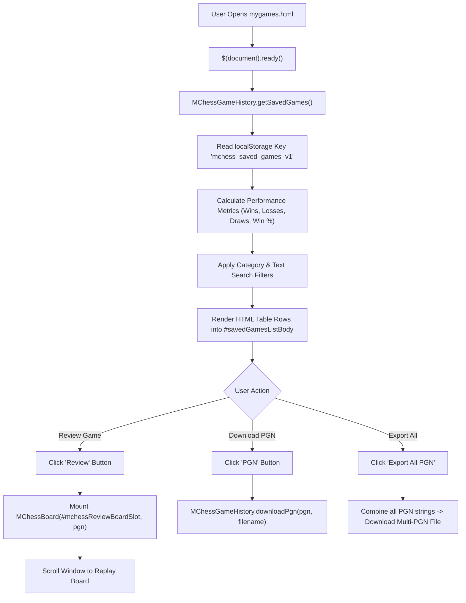

# Page Documentation: My Played Games Archive (`mygames.html`)

> [!NOTE]
> `mygames.html` provides players with a dedicated match history dashboard, performance statistics (Victories, Defeats, Draws, Win Rate %), search and filter controls, interactive move-by-move game review board (`MChessBoard`), and PGN export capabilities powered by client-side HTML5 `localStorage`.

---

## 1. Page Layout & ASCII Wireframe

```
+-----------------------------------------------------------------------------------+
|  HEADER & NAVIGATION COMPONENTS (Dynamic AJAX Injection)                           |
+-----------------------------------------------------------------------------------+
|  PAGE HEADER: "My Played Games Archive"                                           |
|  [ Play vs Computer Button ]  [ Play Online Arena Button ]                        |
+-----------------------------------------------------------------------------------+
|  PLAYER PERFORMANCE STATS CARDS GRID                                              |
|  +---------------+  +---------------+  +---------------+  +--------------------+  |
|  | Total Matches |  | Victories     |  | Defeats       |  | Win Rate %         |  |
|  | [ 14 ]        |  | [ 9 ]         |  | [ 3 ]         |  | [ 64% ]            |  |
|  +---------------+  +---------------+  +---------------+  +--------------------+  |
+-----------------------------------------------------------------------------------+
|  MOVE-BY-MOVE REPLAY BOARD CONTAINER (#reviewBoardContainer - Expandable)         |
|  [ Heading: Player vs Stockfish ]  [ Download PGN Button ]  [ Close Review Button]|
|  +---------------------------------------------+-------------------------------+  |
|  |                                             |  SAN MOVE LIST                |  |
|  |         INTERACTIVE CHESSBOARD              |  1. e4 e5                     |  |
|  |         (#mchessReviewBoardSlot)            |  2. Nf3 Nc6                   |  |
|  |                                             |  3. Bc4 Bc5                   |  |
|  +---------------------------------------------+-------------------------------+  |
|  [ |< First ] [ < Prev ] [ Next > ] [ Last >| ] [ Flip Board ] [ Auto Play ]      |
+-----------------------------------------------------------------------------------+
|  FILTER & SEARCH BAR                                                              |
|  [ Filter: All | Wins | Losses | Draws ] [ Search: Input ] [ Export All PGN ]     |
+-----------------------------------------------------------------------------------+
|  SAVED GAMES TABLE (#savedGamesListBody)                                          |
|  [ Date & Time | Matchup | Mode / Control | Result | Moves | Action Buttons ]     |
|  - 2026-08-21 11:30 | You vs Stockfish (Lv 10) | 5m Blitz | 1-0 | 34 | Review/PGN/Del|
+-----------------------------------------------------------------------------------+
|  FOOTER COMPONENT (Dynamic AJAX Injection)                                        |
+-----------------------------------------------------------------------------------+
```

---

## 2. Architecture & Data Flow



---

## 3. Key Modules & Source References

| Component / Function | File Location | Responsibility |
| :--- | :--- | :--- |
| HTML View | [mygames.html](../../mygames.html) | Semantic page layout, stats cards, and table structure |
| Dedicated Page Styles | [css/mygames.css](../../css/mygames.css) | `--mg-*` Theme custom properties, stats cards, filter bar, table, and review container |
| Dedicated Page Logic | [js/mygames.js](../../js/mygames.js) | Statistics calculation with user perspective evaluation (`determineGameOutcome`), category filter tabs, search filtering, review launcher, and PGN export |
| `MChessGameHistory` | [js/mchess-game-history.js](../../js/mchess-game-history.js) | LocalStorage CRUD operations, 7-Tag PGN formatting, `buildPgnFromMoves`, and file export |
| `MChessBoardTheme` | [js/mchess-board-theme.js](../../js/mchess-board-theme.js) | Centralized 5-theme board customizer & modal dialog |
| `MChessBoard` | [js/mchess-board.js](../../js/mchess-board.js) | Move-by-move replay engine, SAN move highlighting, auto-play |
| Navigation Integration | [components/menu.html](../../components/menu.html#L28) | MISC menu link entry |

---

## 4. LocalStorage Persistence Schema (`mchess_saved_games_v1`)

```json
[
  {
    "id": "game_1771661200000_123",
    "date": "23/08/2026 06:15 PM",
    "white": "Gautam (You)",
    "black": "Stockfish AI (Level 10)",
    "userSide": "white",
    "playerName": "Gautam",
    "result": "1-0 (Resignation)",
    "termination": "Resignation",
    "moveCount": 34,
    "mode": "vs Computer (5m)",
    "pgn": "[Event \"vs Computer (5m)\"]\n[Site \"mchess.eg1.in\"]\n[Date \"2026.08.23\"]\n[Round \"1\"]\n[White \"Gautam (You)\"]\n[Black \"Stockfish AI (Level 10)\"]\n[Result \"1-0\"]\n[Termination \"Resignation\"]\n[Mode \"vs Computer (5m)\"]\n\n1. e4 e5 2. Nf3 Nc6 3. Bc4 Bc5 4. O-O Nf6 1-0"
  }
]
```

---

## 5. Performance & Privacy Benefits

> [!TIP]
> - **100% Client-Side Privacy**: Games are stored strictly on the player's device in `localStorage`, meaning zero private game telemetry is sent to any server.
> - **Zero Database Costs**: Uses **0 Firebase Firestore reads/writes**, keeping application hosting completely free.
> - **Multi-PGN Portability**: Players can export all their matches in a single `.pgn` file to import into Chess.com, Lichess, or ChessBase.
