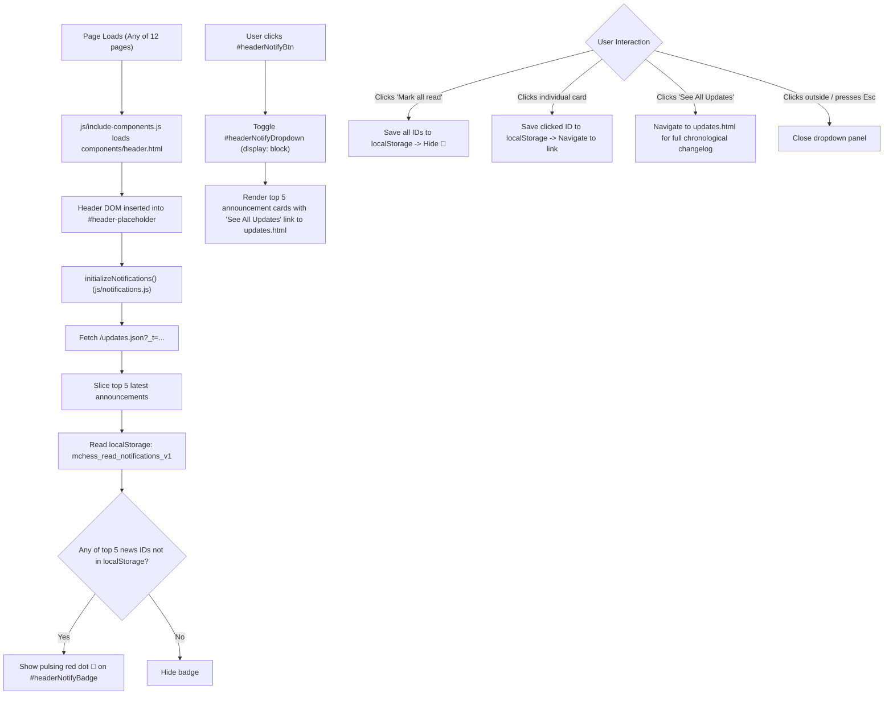

# Page Documentation: In-Site "What's New" Bell Notification System

> [!NOTE]
> The **In-Site "What's New" Bell Notification System** provides a lightweight, zero-permission alert channel for broadcasting new features, tactical puzzle upgrades, blog articles, and platform announcements to visitors across all pages of Marwadi Chess ([mchess.eg1.in](https://mchess.eg1.in)).

---

## 1. System Layout & ASCII Wireframe

```
+-----------------------------------------------------------------------------------+
|  TOP BAR / HEADER (.header-flex-row)                                              |
|  [Logo: Marwadi Chess]              [🔔 🔴] [Play Online] [Theme Toggle 🌙/☀️]     |
|                                        |                                          |
|                                        v (Click opens dropdown)                   |
|                        +-------------------------------------------------------+  |
|                        |  🔔 What's New                     [Mark all read]    |  |
|                        +-------------------------------------------------------+  |
|                        |  [🧩] [PUZZLES]                           Aug 22, 2026|  |
|                        |  Tactical Chessboard Engine Upgrade                   |  |
|                        |  All 15 puzzle diagrams upgraded to 2D vector...  (•) |  |
|                        +-------------------------------------------------------+  |
|                        |  [♞] [FEATURE]                            Aug 20, 2026|  |
|                        |  Play Online Arena is Live                            |  |
|                        |  Challenge opponents with custom time controls...     |  |
|                        +-------------------------------------------------------+  |
|                        |  [🏛️] [HERITAGE]                          Aug 18, 2026|  |
|                        |  Ancient Indian Chess Heritage Article                |  |
|                        |  Discover the 4,500-year evolution of chess...        |  |
|                        +-------------------------------------------------------+  |
|                        |  Browse All Blog Updates →                            |  |
|                        +-------------------------------------------------------+  |
+-----------------------------------------------------------------------------------+
```

---

## 2. Component & Data Flow



---

## 3. Feed Data Schema (`updates.json`)

The announcements feed is maintained in [`data/updates.json`](../../data/updates.json) in the workspace data directory:

```json
[
  {
    "id": "v3-0-0-about-enhancements",
    "version": "3.0.0",
    "title": "Major Updates in About Section",
    "message": "Checkout Marwadi Chess about section and see major updates celebrating 4,500 years of chess heritage with dynamic Grandmaster quotes.",
    "icon": "fa-landmark",
    "badge": "Heritage",
    "badgeColor": "#f59e0b",
    "link": "about.html",
    "date": "Aug 22, 2026",
    "pinned": true
  }
]
```

### Field Specifications:
| Field | Type | Description |
| :--- | :--- | :--- |
| `id` | String | Unique identifier (e.g. `v3-0-0-...`). Used for `localStorage` read diffing. |
| `version` | String | *(Optional)* Release version tag (e.g. `"3.0.0"`), rendered as `v3.0.0` pill tag. |
| `title` | String | Bold announcement headline (1 line). |
| `message` | String | Concise summary description (1–2 sentences). |
| `icon` | String | FontAwesome icon class (e.g. `fa-landmark`, `fa-robot`, `fa-chess-knight`, `fa-palette`, `fa-folder-open`). |
| `badge` | String | Category pill label (e.g. `Heritage`, `AI & Tactics`, `Online Play`, `Archive`, `Design`). |
| `badgeColor` | String | Hex color for icon and category pill (e.g. `#f59e0b`, `#eab308`, `#3b82f6`, `#10b981`, `#8b5cf6`). |
| `link` | String | Relative destination URL opened on click. |
| `date` | String | Human-readable publication date matching git commit history. |
| `pinned` | Boolean | *(Optional)* Pins the announcement to the top of the feed. |

---

## 4. How to Add a New Announcement

Whenever you publish a new article, puzzle, or feature:
1. Open [`data/updates.json`](../../data/updates.json).
2. Prepend a new announcement object at the top of the JSON array:
   ```json
   {
     "id": "news-2026-08-25-01",
     "title": "Your New Announcement Title",
     "message": "Short description of what was added or updated.",
     "icon": "fa-bullhorn",
     "badge": "Update",
     "badgeColor": "#f59e0b",
     "link": "target-page.html",
     "date": "Aug 25, 2026",
     "pinned": false
   }
   ```
3. Commit and deploy. All visitors will immediately see the glowing unread dot (`🔴`) on their next visit!

---

## 5. Key Feature Modules & Source Files

- **Master Feed JSON**: [`data/updates.json`](../../data/updates.json)
- **Header Component**: [`components/header.html`](../../components/header.html)
- **Notification Controller**: [`js/notifications.js`](../../js/notifications.js)
- **Component Loader Script**: [`js/include-components.js`](../../js/include-components.js)
- **Stylesheets**: [`css/common.css`](../../css/common.css)

---

## 6. Open Source & Accessibility Checklist

> [!TIP]
> - **Zero Third-Party Trackers**: No external cookies or tracking scripts are loaded; state tracking is strictly client-side via `localStorage`.
> - **Accessible ARIA**: `#headerNotifyBtn` includes `aria-label="Notifications"` and dynamic `aria-expanded="true/false"`.
> - **Keyboard Navigation**: Pressing <kbd>Escape</kbd> closes the dropdown and returns focus to the bell button.
> - **Dark / Light Theme**: Seamlessly adapts to Dark Mode (`[data-theme="dark"]`) and Light Mode palettes.

---

## 7. Smart Bidirectional Floating Scroll Assistant

In [`js/include-components.js`](../../js/include-components.js) and [`components/footer.html`](../../components/footer.html), the floating button (`#backToTopBtn`) acts as an adaptive vertical scroll assistant:
- **Scroll to Bottom (`fa-chevron-down`)**: Displayed when the user is in the upper 40% of the page to jump directly to bottom training links or footer controls.
- **Scroll to Top (`fa-chevron-up`)**: Automatically flips when scrolled past 40% to return smoothly to the top bar.
- **Glassmorphic Finish**: Semi-transparent amber glass (`rgba(245, 158, 11, 0.68)`, `backdrop-filter: blur(6px)`) with subtle hover feedback.

---

*Document prepared for Marwadi Chess repository architecture. All rights reserved.*
