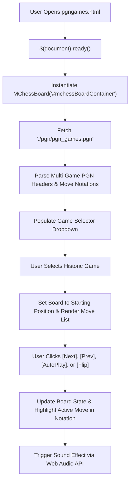

# Page Documentation: PGN Games Database (`pgngames.html`)

> [!NOTE]
> The PGN Games Database page (`pgngames.html` & `js/mchess-board.js`) lets users search, load, and interactively replay historic Grandmaster chess games and opening masterpieces in standard Portable Game Notation (PGN) format.

---

## 1. Page Layout & ASCII Wireframe

```
+-----------------------------------------------------------------------------------+
|  HEADER & NAVIGATION COMPONENTS (Dynamic AJAX Injection)                           |
+-----------------------------------------------------------------------------------+
|  PAGE TITLE: "Browse, analyze, and replay historic chess games played by GMs"    |
+-----------------------------------------------------------------------------------+
|  MCHESS PGN BOARD CONTAINER (#mchessBoardContainer [data-pgn="..."])              |
|                                                                                   |
|  +-- [ Header: Grandmaster PGN Games Database ] -------------------------------+  |
|  |  Active Game: "Garry Kasparov vs Deep Blue (Philadelphia, 1996 - 1-0)"       |  |
|  +-----------------------------------------------------------------------------+  |
|                                                                                   |
|     a   b   c   d   e   f   g   h           +-----------------------------------+ |
|   +---+---+---+---+---+---+---+---+         | GAME SELECTION DROPDOWN           | |
| 8 | r | n | b | q | k | b | n | r | 8       |                                   | |
|   +---+---+---+---+---+---+---+---+         | [ Select GM Game / Match ]        | |
| 7 | p | p | p | p | p | p | p | p | 7       | - Kasparov vs Deep Blue (1996)    | |
|   +---+---+---+---+---+---+---+---+         | - Fischer vs Spassky (1972)       | |
| 6 |   |   |   |   |   |   |   |   | 6       | - Carlsen vs Anand (2013)         | |
|   +---+---+---+---+---+---+---+---+         | - Morphy vs Duke of Brunswick     | |
| 5 |   |   |   |   |   |   |   |   | 5       +-----------------------------------+ |
|   +---+---+---+---+---+---+---+---+         | MOVE LIST NOTATION                | |
| 4 |   |   |   |   |   |   |   |   | 4       | 1. e4 c5   2. Nf3 d6              | |
|   +---+---+---+---+---+---+---+---+         | 3. d4 cxd4 4. Nxd4 Nf6            | |
| 3 |   |   |   |   |   |   |   |   | 3       | 5. Nc3 a6  6. Bg5 e6              | |
|   +---+---+---+---+---+---+---+---+         +-----------------------------------+ |
| 2 | P | P | P | P | P | P | P | P | 2       | REPLAY CONTROLS                   | |
|   +---+---+---+---+---+---+---+---+       - [|< First] [< Prev] [Next >] [>|] | |
| 1 | R | N | B | Q | K | B | N | R | 1       - [ ▶ Auto Play / ⏸ Pause ]         | |
|   +---+---+---+---+---+---+---+---+       - [ 🔄 Flip Board ] [ 🔊 Sound ]     | |
|     a   b   c   d   e   f   g   h                                                 |
+-----------------------------------------------------------------------------------+
|  FOOTER COMPONENT (Dynamic AJAX Injection)                                        |
+-----------------------------------------------------------------------------------+
```

---

## 2. PGN Parser & Board Replay State Flow



---

## 3. Key Assets & Source References

- **Source HTML**: [`pgngames.html`](../../pgngames.html)
- **Board Controller**: [`js/mchess-board.js`](../../js/mchess-board.js)
- **PGN Data File**: [`data/pgn/pgn_games.pgn`](../../data/pgn/pgn_games.pgn)
- **Board Styles**: [`css/mchess-board.css`](../../css/mchess-board.css)
- **Rules & Board Libraries**: `chess.js` (v0.10.3) & `chessboard.js` (v1.0.0)

---

## 4. Performance & Security Notes

> [!TIP]
> - **Client-Side PGN Parsing**: Multi-game PGN databases are split into discrete game records with sanitized tag headers (White, Black, Event, Site, Date, Result, ECO).
> - **Auto-Play Engine**: Provides smooth animated moves (1-second intervals) with instant play/pause toggle.
