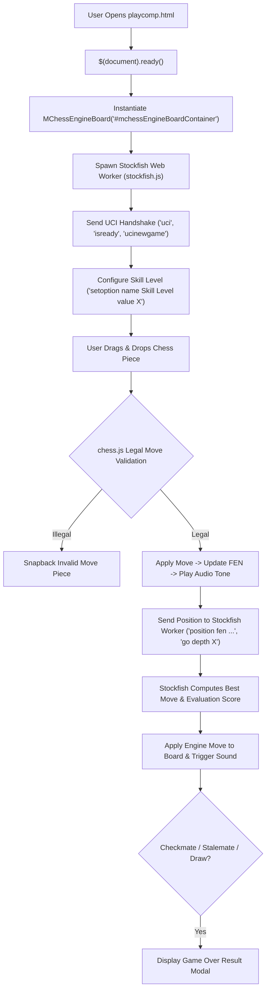

# Page Documentation: Play vs Computer AI Engine (`playcomp.html`)

> [!NOTE]
> Play vs Computer (`playcomp.html` & `js/mchess-engine-board.js`) provides an interactive in-browser chess interface powered by the world's leading open-source chess engine (**Stockfish**) executing via multithreaded JavaScript Web Workers, complete with configurable skill levels, real-time evaluation, move history, and Web Audio sound effects.

---

## 1. Page Layout & ASCII Wireframe

```
+-----------------------------------------------------------------------------------+
|  HEADER & NAVIGATION COMPONENTS (Dynamic AJAX Injection)                           |
+-----------------------------------------------------------------------------------+
|  PAGE TITLE: "Play vs Stockfish Computer Engine"                                  |
+-----------------------------------------------------------------------------------+
|  MCHESS STOCKFISH ENGINE CONTAINER (#mchessEngineBoardContainer)                 |
|                                                                                   |
|  +-- [ Evaluation Bar: White +0.4 ] -------------------------------------------+  |
|  |  Status Banner: "Your turn (White). Stockfish Skill: Level 10 (Master)"     |  |
|  +-----------------------------------------------------------------------------+  |
|                                                                                   |
|     a   b   c   d   e   f   g   h           +-----------------------------------+ |
|   +---+---+---+---+---+---+---+---+         | ENGINE SETTINGS & TIMERS          | |
| 8 | r | n | b | q | k | b | n | r | 8       |                                   | |
|   +---+---+---+---+---+---+---+---+         | Black Clock:  05:00               | |
| 7 | p | p | p | p | p | p | p | p | 7       | White Clock:  04:52               | |
|   +---+---+---+---+---+---+---+---+         +-----------------------------------+ |
| 6 |   |   |   |   |   |   |   |   | 6       | DIFFICULTY SELECTION              | |
|   +---+---+---+---+---+---+---+---+       - [ Easy (Lv 2) ]   [ Medium (Lv 6) ] | |
| 5 |   |   |   |   |   |   |   |   | 5       - [ Hard (Lv 12) ]  [ Master (Lv 20)] | |
|   +---+---+---+---+---+---+---+---+         +-----------------------------------+ |
| 4 |   |   |   | P |   |   |   |   | 4       | PLAY AS: [ White ] [ Black ] [ ? ]| |
|   +---+---+---+---+---+---+---+---+         +-----------------------------------+ |
| 3 |   |   |   |   |   |   |   |   | 3       | MOVE NOTATION HISTORY             | |
|   +---+---+---+---+---+---+---+---+         | 1. e4 e5   2. Nf3 Nc6             | |
| 2 | P | P | P |   | P | P | P | P | 2       | 3. d4 exd4 4. Nxd4                | |
|   +---+---+---+---+---+---+---+---+         +-----------------------------------+ |
| 1 | R | N | B | Q | K | B | N | R | 1       | GAME CONTROLS                     | |
|   +---+---+---+---+---+---+---+---+       - [ New Game ]  [ Flip Board ]        | |
|     a   b   c   d   e   f   g   h           - [ Undo Move ] [ Toggle Audio ]    | |
|                                             - [|< First] [< Prev] [Next >] [>|] | |
|  [ Move Navigation Toolbar: First | Prev | Next | Last | Hint ]                   | |
+-----------------------------------------------------------------------------------+
|  FOOTER COMPONENT (Dynamic AJAX Injection)                                        |
+-----------------------------------------------------------------------------------+
```

---

## 2. Execution Flow & Engine Calculation



---

## 3. Key Functions & Code Map

- **Source HTML**: [`playcomp.html`](../../playcomp.html)
- **Board Stylesheet**: [`css/mchess-board.css`](../../css/mchess-board.css)
- **Engine Board Controller**: [`js/mchess-engine-board.js`](../../js/mchess-engine-board.js)
- **FEN Parser Utility**: [`js/mchess-fen-parser.js`](../../js/mchess-fen-parser.js)
- **Game History Manager**: [`js/mchess-game-history.js`](../../js/mchess-game-history.js) (Auto-archives games for [`mygames.html`](../../mygames.html))
- **Rules Engine**: `chess.js` (v0.10.3)
- **Board UI**: `chessboard.js` (v1.0.0)

### Key Class Methods in `MChessEngineBoard`:

| Method | Description |
| :--- | :--- |
| `constructor(containerEl, options)` | Initializes DOM wrapper, clock intervals, Stockfish worker, and event bindings |
| `initEngineWorker()` | Initializes Web Worker script `stockfish.js` with non-blocking evaluation message listener |
| `setupPosition(fen, orientation)` | Resets board position, syncs `chess.js` instance, updates move history, and starts clocks |
| `onDrop(source, target)` | Validates user drag action against `chess.js`, prompts promotion modal when moving pawn to last rank, updates SAN notation |
| `isPromotionMove(source, target)` | Detects if a move is a legal pawn promotion to rank 8/1 |
| `showPromotionDialog(color, callback)` | Displays glassmorphic interactive piece selector for Queen (♕/♛), Rook (♖/♜), Bishop (♗/♝), and Knight (♘/♞) |
| `getAIMove()` | Sends current FEN to Stockfish worker with appropriate depth based on skill level |
| `updateEvaluationBar(score, isMate)` | Dynamically animates the real-time evaluation bar based on centipawn score |
| `playTone(type)` | Synthesizes move, capture, check, checkmate fanfare (4-note), and stalemate chime via Web Audio API (`AudioContext`) |
| `bindTapToMove()` | Binds 1-click piece selection, legal move dots (`.dest-highlight`), and capture rings (`.dest-capture`) |
| `undoMove()` | Rolls back the move history by 2 plies (reverting both user move and engine response) |

---

## 4. Performance & Security Notes

> [!TIP]
> - **Instant Play as Black Initiation**: Selecting "Play as Black ♚" from the side dropdown automatically invokes `setupPosition()` and immediately instructs Stockfish to play the opening White move (`1. e4`, `1. d4`, etc.) without requiring a manual click on the "Reset" button.
> - **Universal Tap-to-Move**: In addition to drag-and-drop, users can tap a piece to highlight valid destinations with green dots or red capture rings and tap any destination square to execute the move.
> - **Web Worker Threading**: Stockfish calculation runs entirely inside a dedicated background `Worker`, guaranteeing zero UI stutter or dropped frames during deep move calculations.
> - **Web Audio API**: Game sound effects (including custom 4-note Checkmate fanfare and 2-tone Stalemate chime) are dynamically synthesized on-the-fly using browser `AudioContext` oscillators, eliminating external audio asset HTTP requests and latency.
> - **Dynamic ResizeObserver**: Integrated container `ResizeObserver` automatically recalibrates board dimensions and piece placement during mobile orientation shifts or container resizes.
> - **Maximized Mobile Viewport**: Expanded board area to ~95% of mobile screen width with zeroed container gutters.

