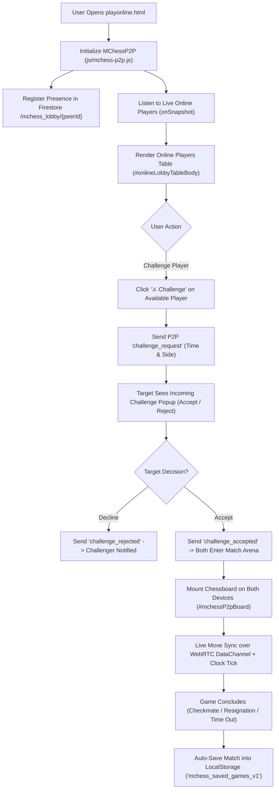

# Page Documentation: Play Online Chess with Friends & Live Lobby (`playonline.html`)

> [!NOTE]
> The Play Online page (`playonline.html`) is a native, real-time 2-player online chess arena powered by **WebRTC Peer-to-Peer (P2P)** (`js/mchess-p2p.js`) and lightweight Firestore lobby presence. Players can see live online players in the lobby, challenge any player with 1 click (with instant Accept/Decline popups), play on our custom SVG board with live clocks and sounds (using **0 Firestore writes during play**), or play locally on the same screen via Pass & Play.

---

## 1. Page Layout & ASCII Wireframe

```
+-----------------------------------------------------------------------------------+
|  HEADER & NAVIGATION COMPONENTS (Dynamic AJAX Injection)                           |
+-----------------------------------------------------------------------------------+
|  TOP PLAYER IDENTITY & STATUS BAR                                                 |
|  [ 🟢 Online ] [ Player Identity: "Gautam" [Edit] ] [ Peer ID: MC-8492 ]          |
|  [ Banner Link: My Played Games Archive (mygames.html) ]                          |
+-----------------------------------------------------------------------------------+
|                                                                                   |
|  VIEW 1: LIVE LOBBY & CHALLENGES (#secLobbyView)                                  |
|  +-----------------------------------------------------------------------------+  |
|  | 🟢 ONLINE PLAYERS IN LOBBY (#onlineLobbyTableBody)                          |  |
|  | Player Identity | Preferred Time | Status (Available/In Match) | Action       |  |
|  | - Gautam (You)   | 5m Blitz       | 🟢 Available               | (You)        |  |
|  | - ChessMaster_AJ | 3m Blitz       | 🟢 Available               | [⚔️Challenge]|  |
|  +-----------------------------------------------------------------------------+  |
|  | [ Direct Invite Link Generator ]  | [ Local Pass & Play (Same Screen) ]     |  |
|  +-----------------------------------------------------------------------------+  |
|  | [ Affiliated Club Hubs: Marwadi on Lichess | ChessBase Playchess Room ]       |  |
|  +-----------------------------------------------------------------------------+  |
|                                                                                   |
|  VIEW 2: LIVE MATCH ARENA (#secMatchArenaView - Visible during active match)      |
|  +-----------------------------------------------------------------------------+  |
|  | White Player: Gautam [ 05:00 ] | [ Match Active ] | Black: Opponent [ 05:00]|  |
|  +---------------------------------------------+-------------------------------+  |
|  |                                             |  LIVE SAN MOVE LIST           |  |
|  |      CUSTOM SVG CHESSBOARD                  |  1. e4 e5                     |  |
|  |      (#mchessP2pBoard)                      |  2. Nf3 Nc6                   |  |
|  |                                             |  3. Bc4 Bc5                   |  |
|  +---------------------------------------------+-------------------------------+  |
|  | [ 🚩 Resign ] [ 🤝 Offer Draw ] [ 🔄 Flip Board ] [ 🚪 Leave Match ]        |  |
|  +-----------------------------------------------------------------------------+  |
+-----------------------------------------------------------------------------------+
|  FOOTER COMPONENT (Dynamic AJAX Injection)                                        |
+-----------------------------------------------------------------------------------+
```

---

## 2. WebRTC P2P & Lobby State Machine Flow



---

## 3. Key Modules & Source References

| Component / Function | File Location | Responsibility |
| :--- | :--- | :--- |
| HTML View & Modals | [`playonline.html`](../../playonline.html) | Lobby table, challenge popups, and live arena layout |
| Dedicated Page Styles | [`css/playonline.css`](../../css/playonline.css) | Lobby cards, matchmaking table, club chips, player clocks, and modal overlays |
| Dedicated Page Logic | [`js/playonline.js`](../../js/playonline.js) | Player identity management, name editing, and `MChessP2P` lifecycle initialization |
| `MChessP2P` Engine | [`js/mchess-p2p.js`](../../js/mchess-p2p.js) | WebRTC PeerJS data channel, Firestore lobby presence, move/clock sync |
| Board & FEN Engine | [`js/mchess-board.js`](../../js/mchess-board.js), [`js/mchess-fen-parser.js`](../../js/mchess-fen-parser.js) | Piece movement validation, coordinates, and board themes |
| Game History Manager | [`js/mchess-game-history.js`](../../js/mchess-game-history.js) | LocalStorage game archiving for [`mygames.html`](../../mygames.html) |
| Firestore Lobby Rules | Cloud Firestore Security Rules | Presence collection authorization and lobby peer validation |

---

## 4. Mobile Responsiveness & Session Recovery

> [!TIP]
> - **Replay-Based Move Tree Reconstruction (`buildChessFromMovesArray`)**: Replays the entire SAN move sequence sequentially on a fresh chess engine instance upon browser refresh or WebRTC reconnection, guaranteeing that internal move history is never lost or wiped.
> - **Persistent Move List Display**: Reconciles the move list table across both engine state and `historyFen` to ensure the move counter never restarts from move 1 on reconnect.
> - **Guaranteed Game Archiving**: Active games are reliably saved to LocalStorage (`mchess_saved_games_v1` / `mygames.html`) with complete move lists upon checkmate, resignation, timeout, draw, or when leaving an active match.
> - **ResizeObserver Auto-Recalibration**: The board container listens for viewport, resize, and device orientation events to immediately recalibrate `chessboard.js` square coordinate hit-boxes.
> - **Tap-to-Move (Click-to-Move)**: In addition to drag-and-drop, mobile users can tap any friendly piece to illuminate valid move destination dots (`.dest-highlight`), then tap the destination square to move.
> - **Universal Pawn Promotion**: Players promoting a pawn to the 8th/1st rank can choose between ♕ Queen, ♖ Rook, ♗ Bishop, or ♘ Knight via the interactive promotion modal, which automatically syncs the exact promotion piece across WebRTC to the opponent.
> - **Self-Healing Hybrid Move Sync**: Transmits both action notation, SAN history arrays, and authoritative FEN snapshots (`msg.fen`). If any engine desync occurs, the engine automatically reconciles without dropping moves or requiring browser reloads.
> - **Move Delivery ACKs & Retransmit**: Outbound moves are tracked with lightweight `move_ack` confirmation and fast retransmission if an ACK is missing.
> - **10-Second State Heartbeat**: Active peers exchange periodic state checks with move history validation to silently correct any micro-drift over WebRTC.
> - **Active Session Reconnection**: If a player accidentally refreshes their browser (`F5`), the active match state is restored from `sessionStorage` and reconnected over WebRTC without losing move progress or clock times.
> - **30-Second Disconnection Grace Period**: When a player loses connection, the opponent's screen begins a 30s countdown. If the player returns within 30s, the match resumes seamlessly; if not, victory is awarded by abandonment.
> - **1 Single Write per Visitor**: Joining the lobby writes 1 document to `/mchess_lobby/{peerId}`.
> - **0 Writes During Gameplay**: All piece movements, clocks, checkmates, and resignations travel **directly browser-to-browser via WebRTC DataChannels**, consuming **zero Firebase database quota**.
> - **In-House Native Branding**: Players stay 100% on `mchess.eg1.in` using our custom SVG chessboard without any third-party redirections.


