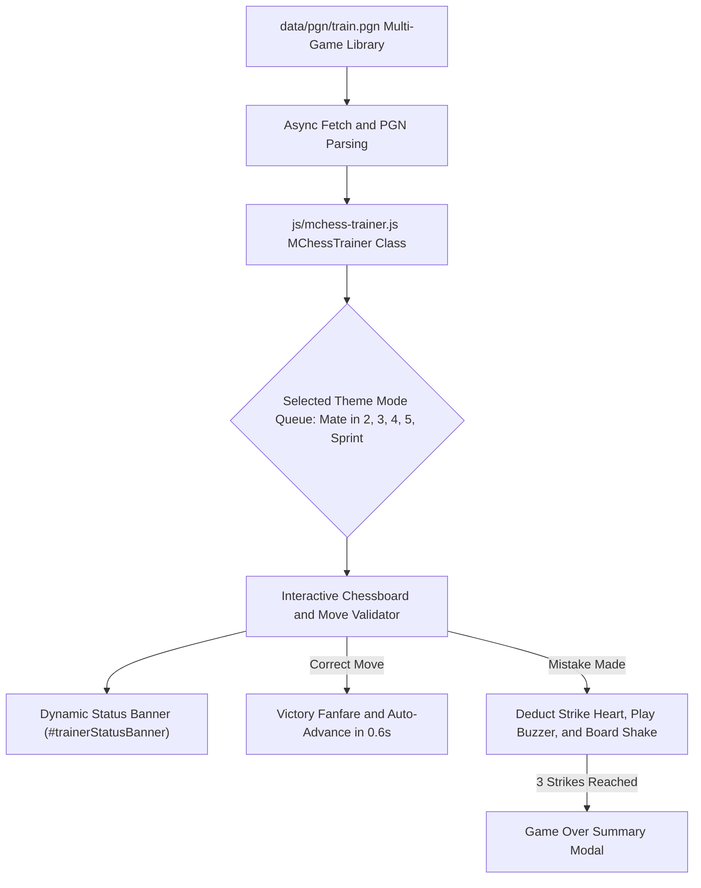

# Page Details: Train Yourself Tactics Arena (`train.html`)

**Page File:** [train.html](../../train.html)  
**Styles:** [css/train.css](../../css/train.css), [css/mchess-board.css](../../css/mchess-board.css), [css/mchess-board-theme.css](../../css/mchess-board-theme.css)  
**Scripts:** [js/mchess-trainer.js](../../js/mchess-trainer.js), [data/pgn/train.pgn](../../data/pgn/train.pgn), [js/mchess-fen-parser.js](../../js/mchess-fen-parser.js)  
**Category:** Interactive Tactics & Calculation Training  

---

## 📌 Overview

The **Train Yourself Tactics Arena** page (`train.html`) is a fast-paced chess calculation and puzzle training environment designed to help players sharpen checkmate recognition under rapid time controls with a 3-strike survival ruleset.

---

## ⚙️ Architecture & Data Flow



---

## 🎯 Key Features & Enhancements

1. **Centralized Mount Container**: All UI components (header, mode pills, timer, hearts, chessboard, action bar, status banner) are consolidated dynamically inside `#mchessTrainerContainer`, eliminating redundant static HTML boilerplate.
2. **Dynamic Feedback Status Banner**:
   - `#trainerStatusBanner` containing `#trainerStatusText` displays contextual prompt instructions, turn indicators, and move accuracy feedback.
   - Smoothly transitions with `.fadeIn(150)` and auto-hides when cleared.
3. **Unified Action Buttons (`.btn-trainer-act`)**:
   - Harmonized controls bar across Skip, Hint, Flip Board, and Zen Mode with responsive icon badges and accessible touch targets.
4. **Mobile Responsive Auto-Resize**:
   - `handleResponsiveResize()` dynamically checks viewport boundaries ($\le 860\text{px}$) and resizes `.board-wrapper` to 100% width with zero horizontal clipping.
5. **Strict Checkmate Verification**: 100% of the **500 puzzles** in [data/pgn/train.pgn](../../data/pgn/train.pgn) are extracted from 21,380+ real games and mathematically verified via `python-chess` to terminate in checkmate `#`.
6. **Category Modes & Ply Counts**:
   - **Mate in 2** (`mateIn2` — 100 puzzles): 2-move checkmates (3 plies).
   - **Mate in 3** (`mateIn3` — 100 puzzles): 3-move checkmates (5 plies).
   - **Mate in 4** (`mateIn4` — 100 puzzles): 4-move checkmates (7 plies).
   - **Mate in 5** (`mateIn5` — 100 puzzles): 5-move checkmates (9 plies).
   - **Mixed Sprint** (`sprint` / `all` — 100 puzzles): Rapid-fire tactical finishes.
7. **Interactive Pawn Promotion & Underpromotion**:
   - Displays a glassmorphic promotion modal allowing the player to promote to ♛ Queen, ♜ Rook, ♝ Bishop, or ♞ Knight.
   - Validates exact tactical underpromotions (e.g. `c1=R` in Puzzle #01) vs standard queen promotions.
8. **3-Strikes Survival System**: Players start with 3 hearts (❤️❤️❤️). Incorrect moves trigger a board shake animation and deduct 1 heart.
9. **Time Controls**: 3 Minutes (Sprint), 5 Minutes (Blitz), and Unlimited (Survival Mode).
10. **Focused Zen Board Mode**: Distraction-free calculation overlay mode maximizing the chessboard view.
11. **Dynamic Stockfish Defense & Pre-Move Bestmove Verification**:
    - For unscripted defensive branches, Stockfish evaluates the position before the player's move to confirm `bestmove`.
    - Scaled evaluation timeouts (2s for Mate in 2, 4s for Mate in 3, 6s for Mate in 4) with strict move budget enforcement.
    - Enforces immediate checkmate on the final turn ($k = N$).
12. **Web Audio Sound Effects**: Zero-asset synthesizer sounds for moves, captures, checks, error buzzers, and victory fanfares.
13. **Streak & Record Persistence**: Tracks current streak and saves all-time Personal Best record to `localStorage`.

---

## 💻 Key Implementation Snippets

### Dynamic Status Banner Update (`updateStatusBanner`)

```javascript
updateStatusBanner(html) {
    const $banner = this.$container.find('#trainerStatusBanner');
    const $text = this.$container.find('#trainerStatusText');
    if (!html || !html.trim()) {
        $banner.stop(true, true).hide();
        $text.html('');
    } else {
        $text.html(html);
        $banner.stop(true, true).css('display', 'inline-flex').hide().fadeIn(150);
    }
}
```

### Responsive Mobile Board Resizing (`handleResponsiveResize`)

```javascript
handleResponsiveResize() {
    if (!this.board) return;
    const isMobile = (window.innerWidth || document.documentElement.clientWidth) <= 860;
    if (isMobile) {
        const $wrapper = $('#' + this.boardId).closest('.board-wrapper');
        if ($wrapper.length) {
            $wrapper.css({ 'width': '100%', 'max-width': '100%' });
        }
    }
    this.board.resize();
}
```
