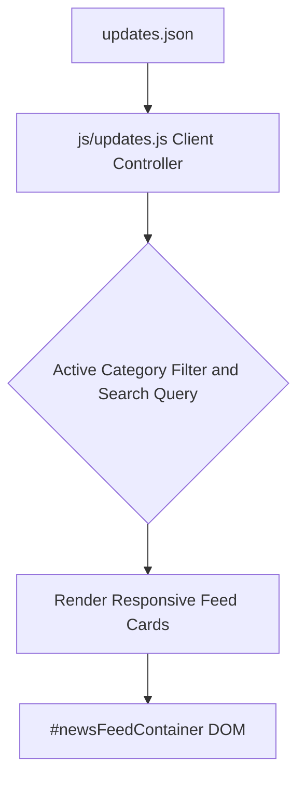

# Page Details: What's New & Release Notes (`updates.html`)

**Page File:** [updates.html](../../updates.html)  
**Styles:** [css/news.css](../../css/news.css)  
**Scripts:** [js/updates.js](../../js/updates.js), [data/updates.json](../../data/updates.json)  
**Category:** Portal Feed & Changelog  

---

## 📌 Overview

The **What's New & Release Notes** page (`updates.html`) provides a centralized, interactive changelog of all feature additions, Stockfish AI engine upgrades, bug fixes, UI/UX optimizations, and performance improvements across Marwadi Chess.

---

## ⚙️ Architecture & Data Flow

---

## 🎯 Key Features

1. **Latest Updates First**: Loads announcements in reverse chronological order with pinned release tags (Latest: **v3.9.1** Bug Fixes).
2. **Category Filtering**: 1-click filter chips for `All`, `Features`, `Bug Fixes`, `Optimizations`, and `AI & Tactics`.
3. **Real-Time Search**: Instant client-side text filtering across release titles, messages, versions, and tags.
4. **Direct Context Navigation**: Every release card includes a customized action link (e.g. `Explore Feature on Play Online →`) pointing directly to the relevant feature page.
5. **Theme Compatibility**: Supports seamless dark mode and light mode switching via CSS custom properties.
6. **SEO & Structured Data**: Complete Schema.org WebPage JSON-LD and Open Graph / X (Twitter) social sharing tags.
