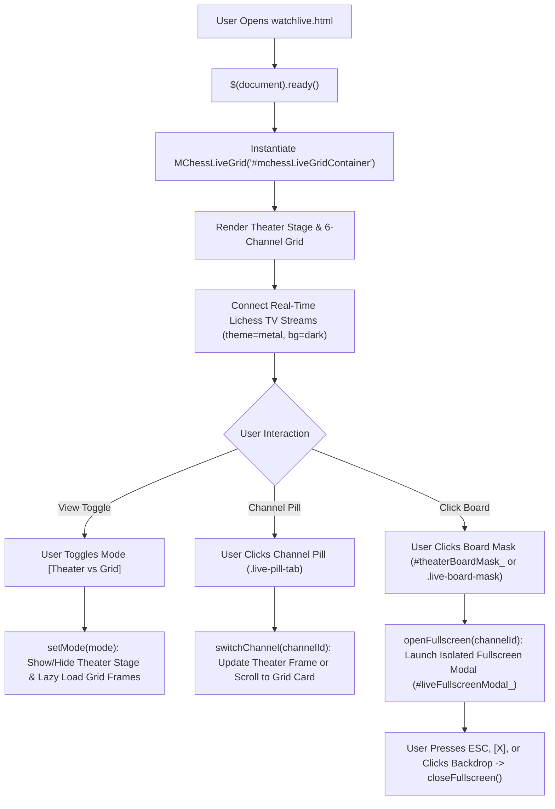

# Page Documentation: Watch Live Games (`watchlive.html`)

> [!NOTE]
> Watch Live Games (`watchlive.html` & `js/mchess-live-board.js`) provides a real-time multi-channel broadcast center streaming ongoing international matches, Grandmaster showdowns, blitz championships, and speed chess across 6 dedicated live channels. It features **Theater Mode**, **Multi-Board Grid Mode**, channel selection pills, and isolated click-to-expand fullscreen viewing.

---

## 1. Page Layout & ASCII Wireframe

```
+-----------------------------------------------------------------------------------+
|  HEADER & NAVIGATION COMPONENTS (Dynamic AJAX Injection)                           |
+-----------------------------------------------------------------------------------+
|  PAGE TITLE: "Live Multi-Channel Chess Broadcasts (6 Channels)"                  |
|  VIEW MODE TOGGLES: [ 🎬 Theater Mode ]  [ ⊞ 6-Board Grid ]                       |
+-----------------------------------------------------------------------------------+
|  CHANNEL SELECTION PILLS (.live-pill-tab)                                         |
|  [ 🏆 Top GM ] [ ⚡ Blitz ] [ ⏱ Rapid ] [ 🔥 Bullet ] [ 👑 Classical ] [ 🚀 Ultra ]|
+-----------------------------------------------------------------------------------+
|  THEATER MODE STAGE (#liveTheaterStage - Default Active View)                     |
|                                                                                   |
|  +-- [ Broadcast Header Bar ] -------------------------------------------------+  |
|  |  🏆 Top GM Broadcast (Highest-rated live game)         [ ⛶ Fullscreen ]     |  |
|  +-----------------------------------------------------------------------------+  |
|  |                                                                             |  |
|  |  +---------------------------------------+  +-----------------------------+ |  |
|  |  | THEATER LIVESTREAM FRAME              |  | BROADCAST INFO PANEL        | |  |
|  |  | (#theaterFrame / Lichess TV Frame)    |  | Channel: Top Grandmasters   | |  |
|  |  |                                       |  | Quality: 1080p Real-Time    | |  |
|  |  | Transparent #theaterBoardMask         |  | Feed: Official Lichess TV   | |  |
|  |  | (Click opens isolated fullscreen modal|  | [ ↗ Open on Lichess ]       | |  |
|  |  |  preventing unwanted navigation)     |  +-----------------------------+ |  |
|  |  +---------------------------------------+                                 |  |
|  +-----------------------------------------------------------------------------+  |
|                                                                                   |
|  MULTI-BOARD BROADCAST GRID (#liveGridWrapper - Toggled via [ ⊞ 6-Board Grid ])   |
|  +---------------------------+ +---------------------------+ +------------------+ |
|  | 🏆 Top GM Broadcast       | | ⚡ Blitz Championship     | | ⏱ Rapid Stream   | |
|  | [ LIVE ] [ ⛶ Fullscreen ] | | [ LIVE ] [ ⛶ Fullscreen ] | | [ LIVE ] [ ⛶ ]   | |
|  | +-----------------------+ | | +-----------------------+ | | +--------------+ | |
|  | | Live Board 1 (Top GM) | | | | Live Board 2 (Blitz)  | | | | Live Board 3   | | |
|  | +-----------------------+ | | +-----------------------+ | | +--------------+ | |
|  +---------------------------+ +---------------------------+ +------------------+ |
+-----------------------------------------------------------------------------------+
|  FULLSCREEN MODAL OVERLAY (#liveFullscreenModal - Click any board to expand)      |
+-----------------------------------------------------------------------------------+
|  FOOTER COMPONENT (Dynamic AJAX Injection)                                        |
+-----------------------------------------------------------------------------------+
```

---

## 2. Broadcast Data Flow & Channel Filtering



---

## 3. Key Controller Logic & Code Snippets

### 3.1 Channel Registry & Definitions

Configured in [`js/mchess-live-board.js`](../../js/mchess-live-board.js), supporting 6 concurrent Grandmaster and speed chess categories:

```javascript
this.channels = [
    { id: 'best', name: 'Top GM Broadcast', desc: 'Highest-rated live game on Lichess right now.', icon: 'fa-trophy', color: '#f59e0b' },
    { id: 'blitz', name: 'Blitz Championship', desc: 'Fast-paced 3-5 minute blitz battles.', icon: 'fa-bolt', color: '#38bdf8' },
    { id: 'rapid', name: 'Rapid Stream', desc: 'Deep tactical 10-15 minute matches.', icon: 'fa-stopwatch', color: '#10b981' },
    { id: 'bullet', name: 'Bullet Speed Channel', desc: 'Lightning-fast 1-2 minute speed chess.', icon: 'fa-fire', color: '#ef4444' },
    { id: 'classical', name: 'Classical Tournament', desc: 'Long-format deep classical master games.', icon: 'fa-chess-king', color: '#a855f7' },
    { id: 'ultraBullet', name: 'UltraBullet Arena', desc: 'Insane 15-30 second bullet games.', icon: 'fa-meteor', color: '#ec4899' }
];
```

### 3.2 View Mode Switcher (`setMode`)

Allows players to switch between focused Theater Stage and multi-board Grid:

```javascript
setMode(mode) {
    this.viewMode = mode;
    const isTheater = mode === 'theater';

    this.$container.find(`.btn-mode-toggle`).removeClass('active');
    this.$container.find(`.btn-mode-toggle[data-mode="${mode}"]`).addClass('active');

    if (isTheater) {
        this.$container.find(`#liveGridWrapper_${this.uid}`).hide();
        this.$container.find(`#liveTheaterStage_${this.uid}`).fadeIn(200);
        this.switchChannel(this.currentChannel);
    } else {
        this.$container.find(`#liveTheaterStage_${this.uid}`).hide();
        this.$container.find(`#liveGridWrapper_${this.uid}`).css('display', 'grid').hide().fadeIn(200);

        // Lazy load any grid iframes that don't have src set
        this.$container.find('.live-channel-card iframe').each(function () {
            const $iframe = $(this);
            if (!$iframe.attr('src')) {
                $iframe.attr('src', $iframe.data('src'));
            }
        });
    }
}
```

### 3.3 Click-to-Fullscreen Isolation

Transparent `.theater-board-mask` and `.live-board-mask` overlays intercept clicks directly over embedded iframes, opening the isolated modal instead of permitting default external navigation:

```javascript
// Theater Board Click: opens active channel in fullscreen modal, preventing Lichess external navigation
this.$container.off('click', `#theaterBoardMask_${this.uid}, .theater-board-mask`)
    .on('click', `#theaterBoardMask_${this.uid}, .theater-board-mask`, function (e) {
        e.preventDefault();
        e.stopPropagation();
        self.openFullscreen(self.currentChannel);
    });

// Open Fullscreen Modal Handler
openFullscreen(channelId) {
    const channel = this.channels.find(c => c.id === channelId) || this.channels[0];
    const iframeUrl = `https://lichess.org/tv/${channel.id}/frame?theme=metal&bg=dark`;

    this.$container.find(`#modalChannelTitle_${this.uid}`).html(`<i class="fas ${channel.icon}" style="color:${channel.color}; margin-right:8px;"></i> ${channel.name}`);
    this.$container.find(`#modalLiveFrame_${this.uid}`).attr('src', iframeUrl);
    this.$container.find(`#liveFullscreenModal_${this.uid}`).css('display', 'flex').hide().fadeIn(250);
    $('body').css('overflow', 'hidden');
}
```

---

## 4. Key Assets & Source References

- **Source HTML**: [`watchlive.html`](../../watchlive.html)
- **Live Broadcast Controller**: [`js/mchess-live-board.js`](../../js/mchess-live-board.js)
- **Board Stylesheet**: [`css/mchess-board.css`](../../css/mchess-board.css)
- **Global Stylesheet**: [`css/common.css`](../../css/common.css)

---

## 5. Security & Performance Notes

> [!TIP]
> - **Zero-Polling Overhead**: Live game movements are streamed using lightweight, secure HTTPS WebSocket frames directly through the official Lichess open TV endpoints.
> - **Lazy-Loaded Grid Frames**: When operating in Theater Mode, background grid iframes remain unrendered until toggled, conserving device memory and network bandwidth.
> - **Isolated Fullscreen Modal**: Transparent board masks guarantee that clicks never unintentionally navigate users away from the Marwadi Chess web platform, providing an uninterrupted viewing experience.
> - **Responsive Viewport Scaling**: On mobile devices ($\le 860\text{px}$), the theater frame automatically adapts to a 1:1 square ratio with touch-optimized fullscreen controls.
